# 周报

近期继续开展ISAR空间目标的舱体与太阳翼分割实验，整理了ISAR、Aura和NearShoemaker三个数据集上CPGNet与SSPNet的测试结果。有标注训练数量为1、5、10、20、30、40、50，共42组实验；另汇总PNWTFs的5组阶段性结果，并完成固定测试样本的可视化整理。

## 分割实验结果

CPGNet使用 **seg_only_ablation分割消融版本**；SSPNet使用 **semi_supervised半监督版本**，三个数据集的无标注样本数量分别为256−n、189−n、139−n。公共设置为 **seed 42、输入512×512**，测试集分别为38、25、18张。1至20-shot训练50个epoch，30至50-shot训练100个epoch。

以下指标单位均为%。**前景mIoU和Dice只对舱体与太阳翼取类别平均**；全类mIoU还包含背景。三个数据集的背景像素占比为95.61%至96.33%，因此重点观察前景指标，避免仅用像素准确率评价分割效果。

### 不同训练数量的前景mIoU

| 数据集 | 实验 | 1-shot | 5-shot | 10-shot | 20-shot | 30-shot | 40-shot | 50-shot |
| --- | --- | --- | --- | --- | --- | --- | --- | --- |
| TG | CPGNet | 0.00 | 38.06 | 36.67 | 66.10 | 60.24 | 70.27 | 68.34 |
| TG | SSPNet | 3.99 | 25.81 | 3.64 | 15.54 | 4.66 | 14.70 | 2.19 |
| Aura | CPGNet | 0.00 | 58.72 | 71.20 | 78.65 | 84.27 | 87.19 | 89.14 |
| Aura | SSPNet | 1.65 | 1.54 | 1.43 | 2.19 | 0.73 | 22.24 | 6.99 |
| NearShoemaker | CPGNet | 0.00 | 51.37 | 69.18 | 78.15 | 89.17 | 89.53 | 90.68 |
| NearShoemaker | SSPNet | 1.54 | 1.43 | 1.50 | 20.37 | 16.55 | 28.79 | 0.95 |

### 结果分析

CPGNet在Aura和NearShoemaker上从5-shot起随样本数量增加持续改善，50-shot前景mIoU分别达到 **89.14%和90.68%**。ISAR上的最高值出现在40-shot，为70.27%；50-shot降至68.34%，说明增加样本后性能并非始终单调提升。**1-shot时三个数据集均预测为背景，前景mIoU和Dice为0**，与全黑的原始结果图一致。

SSPNet的结果波动较大，三个数据集最高前景mIoU分别为25.81%、22.24%、28.79%。Aura的40-shot配置虽然像素准确率为97.06%，但舱体IoU和Recall均为0；NearShoemaker的50-shot配置把96.84%的测试像素预测为舱体，前景mIoU仅0.95%。当前需优先核查标签映射、伪标签分布和训练配置，尚不能仅凭这些现象确定退化原因。

现有结果均为单一随机种子；训练轮数还随shot档位变化，因此样本数量和训练预算的影响需要进一步分开验证。

## 测试结果展示

以下按数据集列出 **1、5、10、20、30、40、50-shot全部结果**。每档先列Markdown分割指标表，再展示结果拼图；图中左侧为CPGNet，右侧为SSPNet。同一数据集在全部训练数量及两个实验中使用相同四个测试样本。黑色为背景，红色为舱体，绿色为太阳翼。指标单位为%，统计整个测试集；图中为预测标签。

### ISAR

#### 1-shot

| 实验 | 全类mIoU | 前景mIoU | 前景Dice | 前景Precision | 前景Recall | OA | 舱体IoU | 太阳翼IoU |
| --- | --- | --- | --- | --- | --- | --- | --- | --- |
| CPGNet | 32.05 | 0.00 | 0.00 | 0.00 | 0.00 | 96.16 | 0.00 | 0.00 |
| SSPNet | 31.44 | 3.99 | 7.66 | 5.06 | 16.61 | 85.27 | 3.03 | 4.95 |

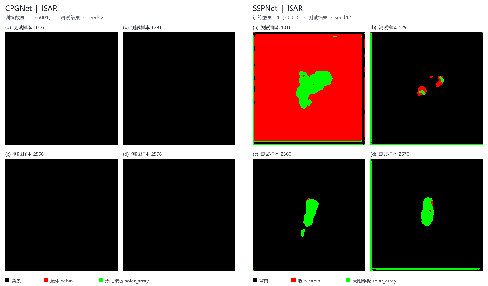

#### 5-shot

| 实验 | 全类mIoU | 前景mIoU | 前景Dice | 前景Precision | 前景Recall | OA | 舱体IoU | 太阳翼IoU |
| --- | --- | --- | --- | --- | --- | --- | --- | --- |
| CPGNet | 58.00 | 38.06 | 43.22 | 41.93 | 44.59 | 97.70 | 76.11 | 0.00 |
| SSPNet | 35.07 | 25.81 | 35.60 | 40.53 | 62.55 | 54.24 | 48.67 | 2.95 |

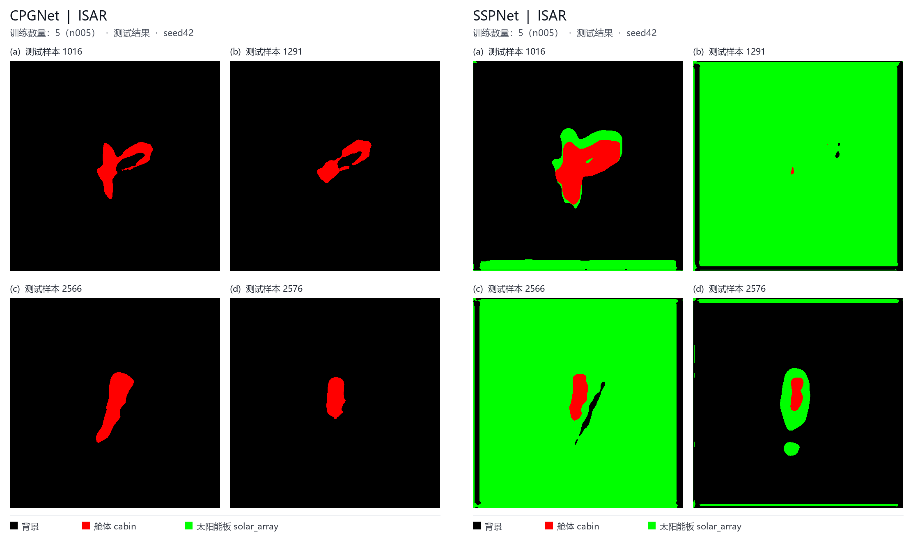

#### 10-shot

| 实验 | 全类mIoU | 前景mIoU | 前景Dice | 前景Precision | 前景Recall | OA | 舱体IoU | 太阳翼IoU |
| --- | --- | --- | --- | --- | --- | --- | --- | --- |
| CPGNet | 57.29 | 36.67 | 48.41 | 59.82 | 50.24 | 97.80 | 62.12 | 11.22 |
| SSPNet | 31.26 | 3.64 | 6.88 | 6.10 | 25.88 | 85.01 | 0.79 | 6.49 |

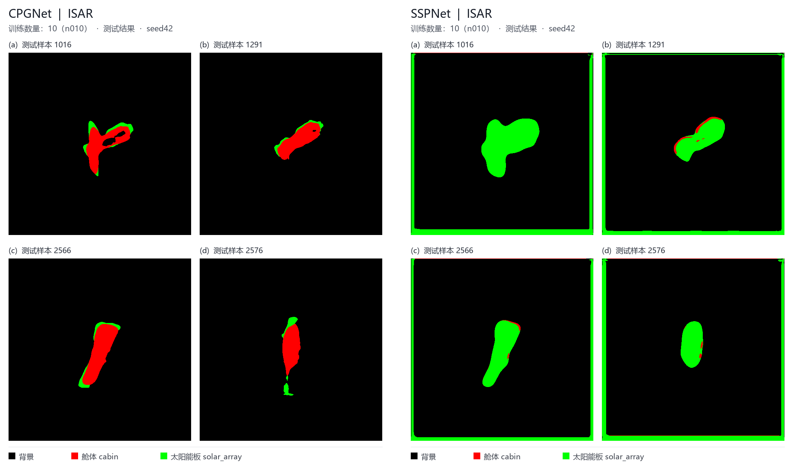

#### 20-shot

| 实验 | 全类mIoU | 前景mIoU | 前景Dice | 前景Precision | 前景Recall | OA | 舱体IoU | 太阳翼IoU |
| --- | --- | --- | --- | --- | --- | --- | --- | --- |
| CPGNet | 77.20 | 66.10 | 79.35 | 84.67 | 78.06 | 98.97 | 73.56 | 58.64 |
| SSPNet | 30.19 | 15.54 | 25.02 | 17.03 | 71.18 | 60.12 | 27.52 | 3.57 |

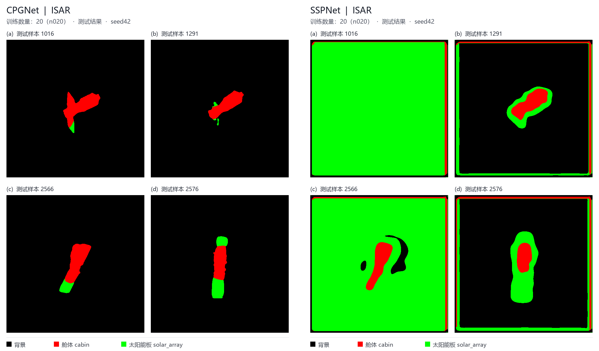

#### 30-shot

| 实验 | 全类mIoU | 前景mIoU | 前景Dice | 前景Precision | 前景Recall | OA | 舱体IoU | 太阳翼IoU |
| --- | --- | --- | --- | --- | --- | --- | --- | --- |
| CPGNet | 73.27 | 60.24 | 74.62 | 83.34 | 73.15 | 98.80 | 71.04 | 49.43 |
| SSPNet | 20.03 | 4.66 | 8.70 | 4.70 | 58.55 | 51.12 | 8.13 | 1.19 |

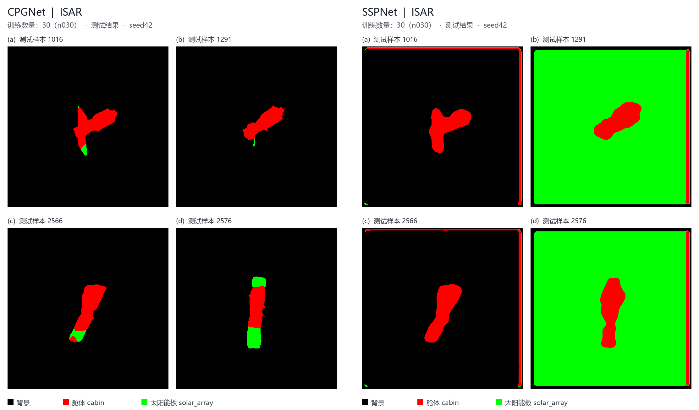

#### 40-shot

| 实验 | 全类mIoU | 前景mIoU | 前景Dice | 前景Precision | 前景Recall | OA | 舱体IoU | 太阳翼IoU |
| --- | --- | --- | --- | --- | --- | --- | --- | --- |
| CPGNet | 80.03 | 70.27 | 82.44 | 85.71 | 81.12 | 99.13 | 75.19 | 65.36 |
| SSPNet | 41.99 | 14.70 | 22.72 | 14.72 | 49.76 | 95.14 | 29.40 | 0.00 |

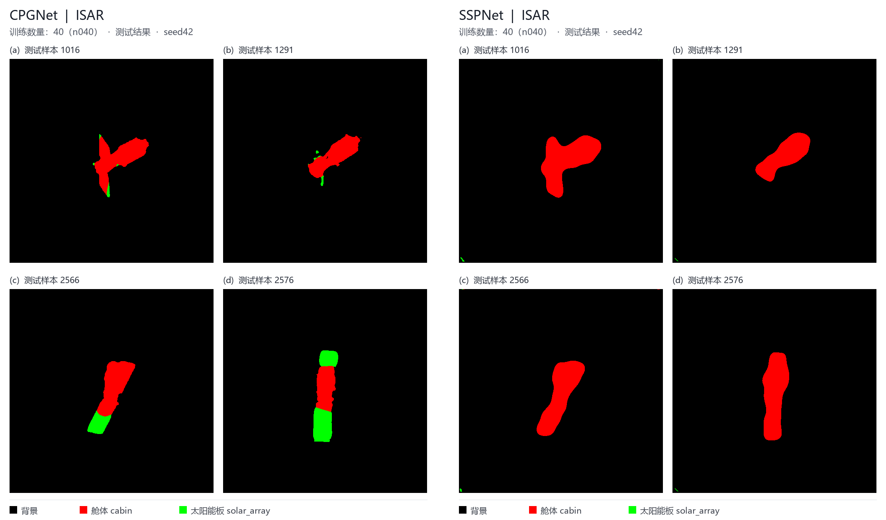

#### 50-shot

| 实验 | 全类mIoU | 前景mIoU | 前景Dice | 前景Precision | 前景Recall | OA | 舱体IoU | 太阳翼IoU |
| --- | --- | --- | --- | --- | --- | --- | --- | --- |
| CPGNet | 78.71 | 68.34 | 81.19 | 81.29 | 81.54 | 99.01 | 69.73 | 66.95 |
| SSPNet | 14.59 | 2.19 | 4.27 | 2.29 | 52.34 | 39.86 | 3.45 | 0.94 |

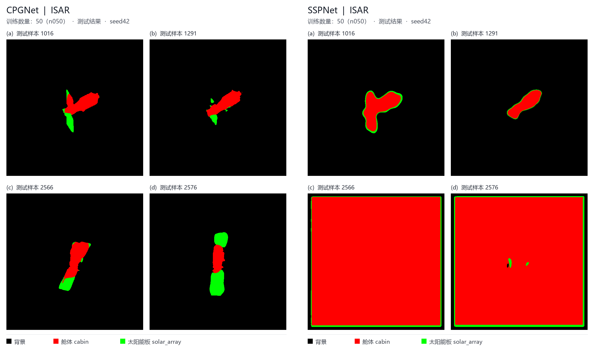

### Aura

#### 1-shot

| 实验 | 全类mIoU | 前景mIoU | 前景Dice | 前景Precision | 前景Recall | OA | 舱体IoU | 太阳翼IoU |
| --- | --- | --- | --- | --- | --- | --- | --- | --- |
| CPGNet | 32.11 | 0.00 | 0.00 | 0.00 | 0.00 | 96.33 | 0.00 | 0.00 |
| SSPNet | 12.98 | 1.65 | 3.19 | 1.65 | 44.67 | 36.60 | 0.00 | 3.29 |

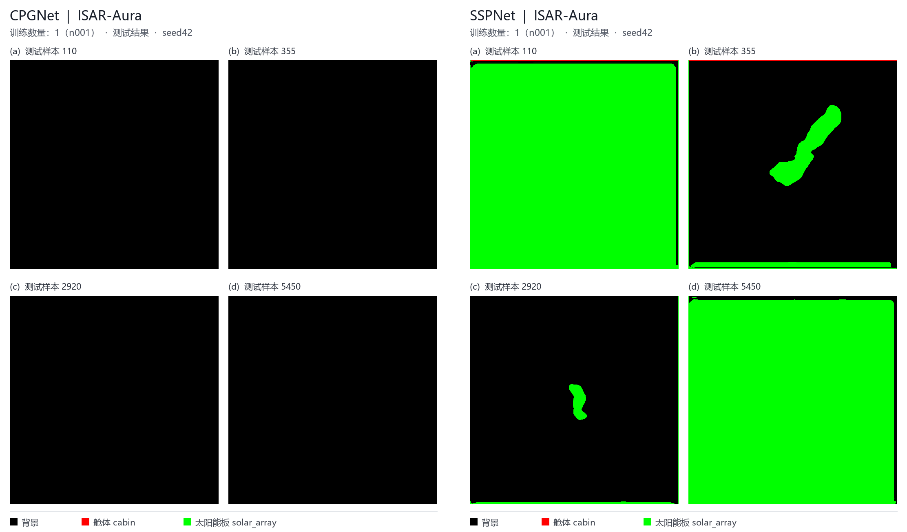

#### 5-shot

| 实验 | 全类mIoU | 前景mIoU | 前景Dice | 前景Precision | 前景Recall | OA | 舱体IoU | 太阳翼IoU |
| --- | --- | --- | --- | --- | --- | --- | --- | --- |
| CPGNet | 72.26 | 58.72 | 73.93 | 75.95 | 72.02 | 98.77 | 55.16 | 62.28 |
| SSPNet | 4.09 | 1.54 | 2.99 | 1.55 | 46.39 | 11.07 | 0.09 | 2.99 |

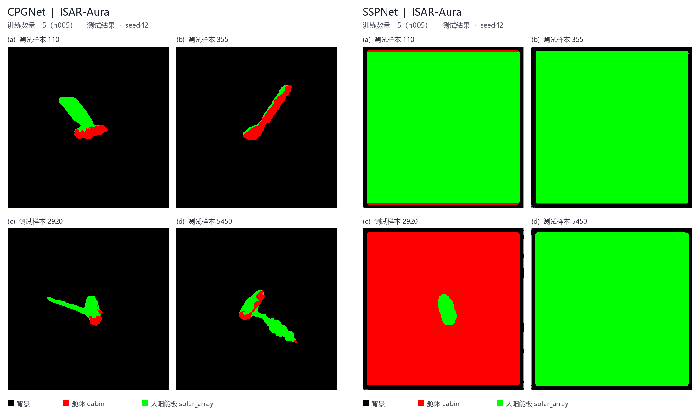

#### 10-shot

| 实验 | 全类mIoU | 前景mIoU | 前景Dice | 前景Precision | 前景Recall | OA | 舱体IoU | 太阳翼IoU |
| --- | --- | --- | --- | --- | --- | --- | --- | --- |
| CPGNet | 80.62 | 71.20 | 83.15 | 85.36 | 81.05 | 99.15 | 68.29 | 74.12 |
| SSPNet | 6.39 | 1.43 | 2.78 | 1.43 | 50.00 | 18.13 | 0.00 | 2.86 |

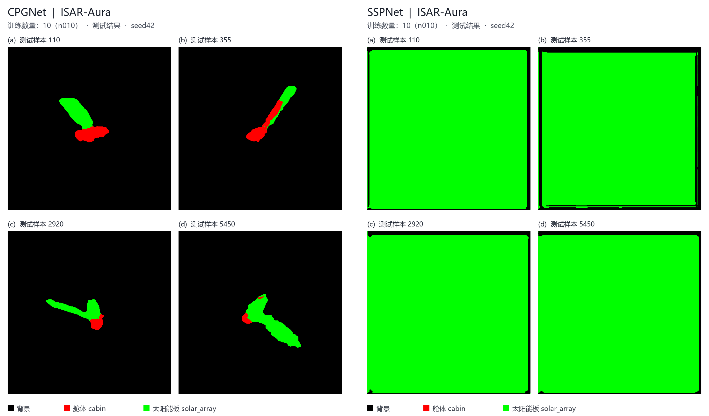

#### 20-shot

| 实验 | 全类mIoU | 前景mIoU | 前景Dice | 前景Precision | 前景Recall | OA | 舱体IoU | 太阳翼IoU |
| --- | --- | --- | --- | --- | --- | --- | --- | --- |
| CPGNet | 85.61 | 78.65 | 88.02 | 87.68 | 88.37 | 99.35 | 75.60 | 81.70 |
| SSPNet | 18.28 | 2.19 | 4.20 | 2.20 | 46.63 | 50.94 | 0.00 | 4.38 |

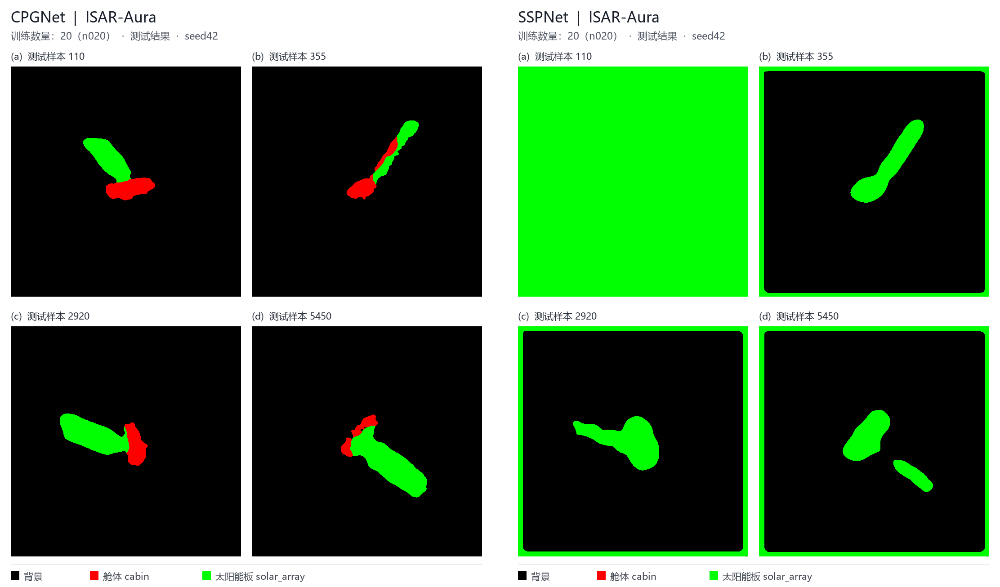

#### 30-shot

| 实验 | 全类mIoU | 前景mIoU | 前景Dice | 前景Precision | 前景Recall | OA | 舱体IoU | 太阳翼IoU |
| --- | --- | --- | --- | --- | --- | --- | --- | --- |
| CPGNet | 89.40 | 84.27 | 91.44 | 92.48 | 90.44 | 99.55 | 81.84 | 86.69 |
| SSPNet | 2.91 | 0.73 | 1.43 | 0.73 | 50.00 | 8.28 | 1.45 | 0.00 |

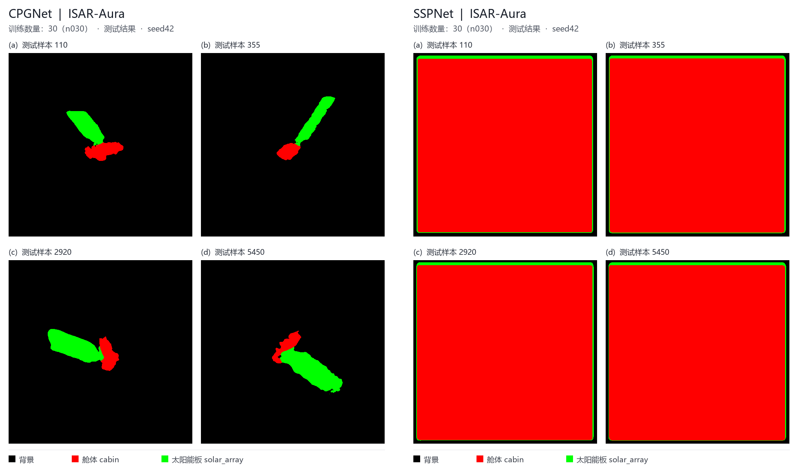

#### 40-shot

| 实验 | 全类mIoU | 前景mIoU | 前景Dice | 前景Precision | 前景Recall | OA | 舱体IoU | 太阳翼IoU |
| --- | --- | --- | --- | --- | --- | --- | --- | --- |
| CPGNet | 91.37 | 87.19 | 93.14 | 93.87 | 92.43 | 99.64 | 85.08 | 89.29 |
| SSPNet | 47.57 | 22.24 | 30.79 | 22.50 | 48.72 | 97.06 | 0.00 | 44.48 |

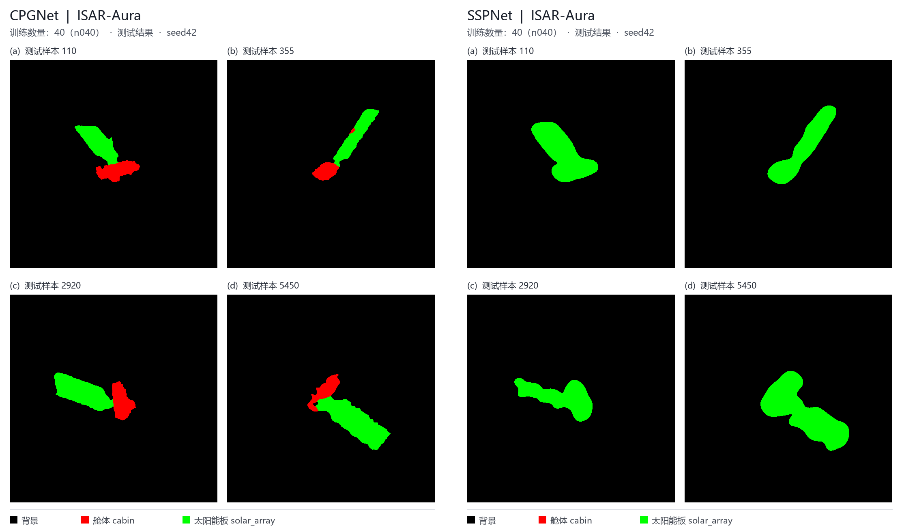

#### 50-shot

| 实验 | 全类mIoU | 前景mIoU | 前景Dice | 前景Precision | 前景Recall | OA | 舱体IoU | 太阳翼IoU |
| --- | --- | --- | --- | --- | --- | --- | --- | --- |
| CPGNet | 92.66 | 89.14 | 94.25 | 95.46 | 93.10 | 99.66 | 87.71 | 90.57 |
| SSPNet | 32.94 | 6.99 | 12.27 | 7.18 | 42.10 | 84.09 | 0.00 | 13.99 |

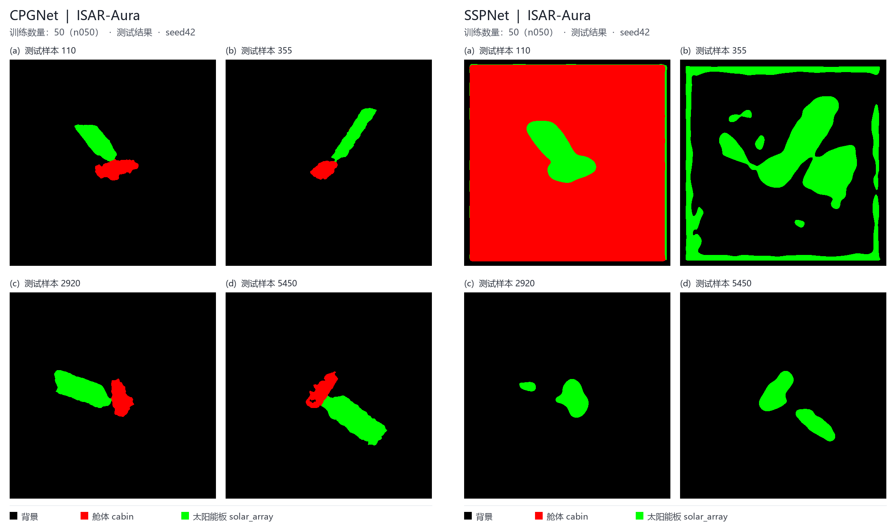

### NearShoemaker

#### 1-shot

| 实验 | 全类mIoU | 前景mIoU | 前景Dice | 前景Precision | 前景Recall | OA | 舱体IoU | 太阳翼IoU |
| --- | --- | --- | --- | --- | --- | --- | --- | --- |
| CPGNet | 31.87 | 0.00 | 0.00 | 0.00 | 0.00 | 95.61 | 0.00 | 0.00 |
| SSPNet | 6.90 | 1.54 | 2.99 | 1.59 | 48.93 | 19.35 | 0.05 | 3.03 |

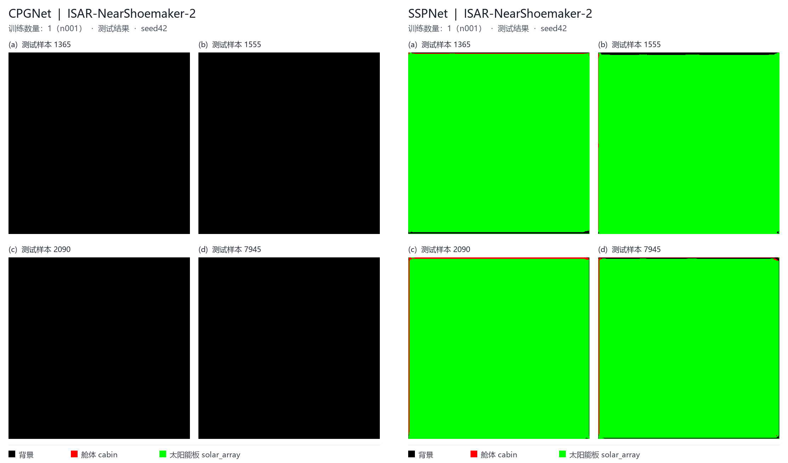

#### 5-shot

| 实验 | 全类mIoU | 前景mIoU | 前景Dice | 前景Precision | 前景Recall | OA | 舱体IoU | 太阳翼IoU |
| --- | --- | --- | --- | --- | --- | --- | --- | --- |
| CPGNet | 66.60 | 51.37 | 65.04 | 59.33 | 71.99 | 96.74 | 73.31 | 29.44 |
| SSPNet | 2.95 | 1.43 | 2.78 | 1.43 | 50.00 | 8.29 | 0.00 | 2.86 |

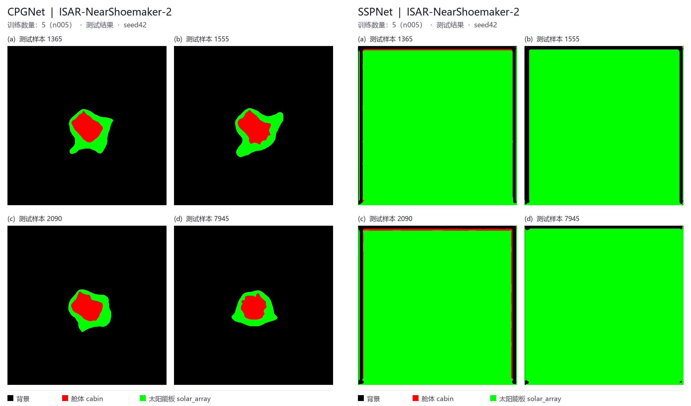

#### 10-shot

| 实验 | 全类mIoU | 前景mIoU | 前景Dice | 前景Precision | 前景Recall | OA | 舱体IoU | 太阳翼IoU |
| --- | --- | --- | --- | --- | --- | --- | --- | --- |
| CPGNet | 78.99 | 69.18 | 81.26 | 75.98 | 87.35 | 98.39 | 80.36 | 58.00 |
| SSPNet | 4.10 | 1.50 | 2.93 | 1.57 | 51.86 | 10.84 | 2.31 | 0.69 |

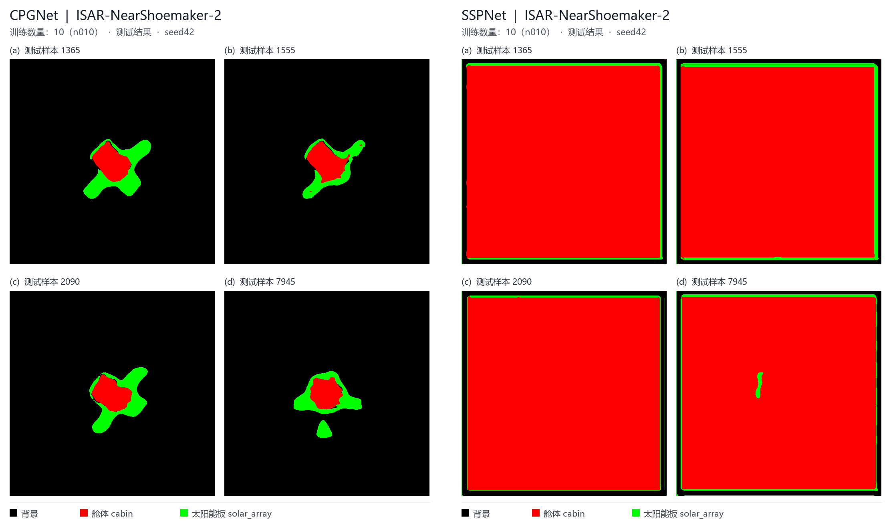

#### 20-shot

| 实验 | 全类mIoU | 前景mIoU | 前景Dice | 前景Precision | 前景Recall | OA | 舱体IoU | 太阳翼IoU |
| --- | --- | --- | --- | --- | --- | --- | --- | --- |
| CPGNet | 85.13 | 78.15 | 87.52 | 87.05 | 88.04 | 98.99 | 85.83 | 70.46 |
| SSPNet | 40.22 | 20.37 | 29.95 | 20.57 | 57.79 | 79.39 | 38.57 | 2.16 |

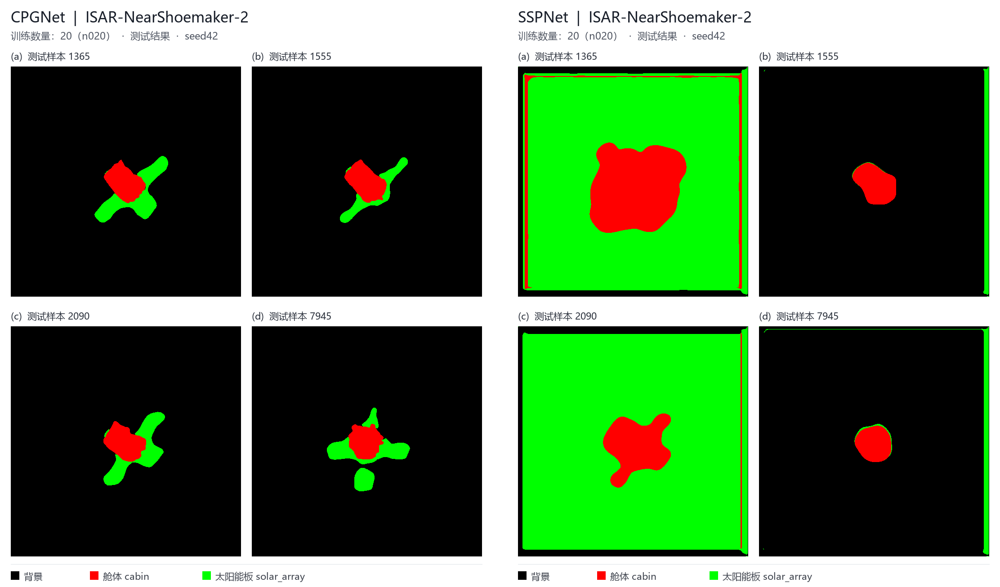

#### 30-shot

| 实验 | 全类mIoU | 前景mIoU | 前景Dice | 前景Precision | 前景Recall | OA | 舱体IoU | 太阳翼IoU |
| --- | --- | --- | --- | --- | --- | --- | --- | --- |
| CPGNet | 92.66 | 89.17 | 94.26 | 93.58 | 94.98 | 99.57 | 90.97 | 87.37 |
| SSPNet | 25.03 | 16.55 | 25.13 | 16.66 | 55.73 | 42.48 | 32.51 | 0.60 |

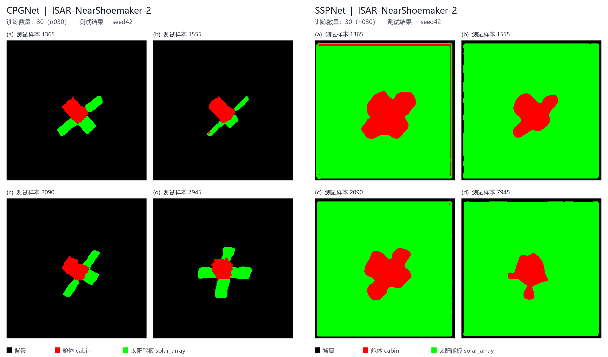

#### 40-shot

| 实验 | 全类mIoU | 前景mIoU | 前景Dice | 前景Precision | 前景Recall | OA | 舱体IoU | 太阳翼IoU |
| --- | --- | --- | --- | --- | --- | --- | --- | --- |
| CPGNet | 92.91 | 89.53 | 94.47 | 95.00 | 93.95 | 99.59 | 90.92 | 88.15 |
| SSPNet | 48.47 | 28.79 | 37.52 | 29.23 | 53.28 | 87.40 | 55.88 | 1.70 |

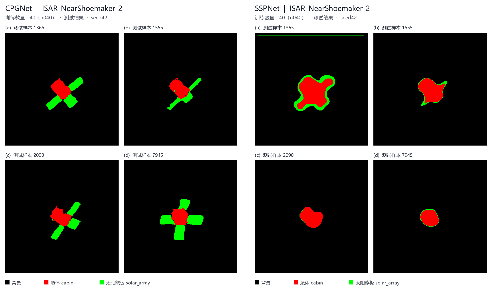

#### 50-shot

| 实验 | 全类mIoU | 前景mIoU | 前景Dice | 前景Precision | 前景Recall | OA | 舱体IoU | 太阳翼IoU |
| --- | --- | --- | --- | --- | --- | --- | --- | --- |
| CPGNet | 93.69 | 90.68 | 95.11 | 95.50 | 94.72 | 99.65 | 90.69 | 90.66 |
| SSPNet | 1.59 | 0.95 | 1.86 | 0.95 | 50.00 | 4.59 | 1.90 | 0.00 |

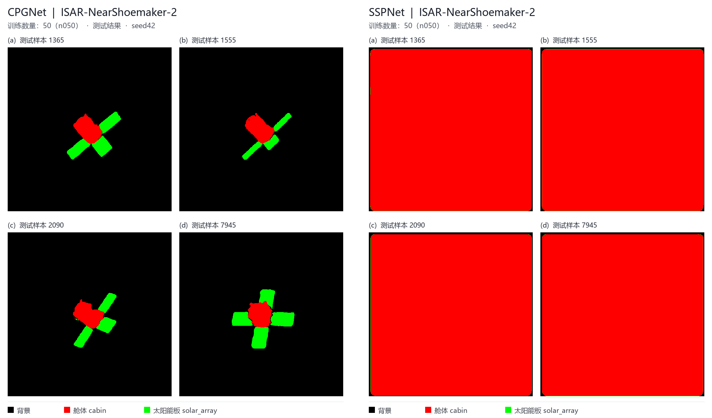

## PNWTFs阶段性结果

PNWTFs采用 **paper_modules_fixed_budget** 版本，当前仅有ISAR数据集1、5、10、20、30-shot指标，前景mIoU依次为 **31.83%、66.73%、67.32%、81.04%、82.32%**。30-shot的前景Dice为90.28%，前景mIoU比相同档位CPGNet高22.08个百分点。

**另外两个数据集及40、50-shot结果尚未记录，暂不作完整排名。** 现有PNWTFs图像只覆盖1至20-shot，其中20-shot仅导出18张，而指标表记录38张测试图像，需补齐并核对评估范围。
