# 周报（SSPNet与PNWTFs分割实验）

近期围绕空间目标的舱体与太阳翼分割，完成实验02（SSPNet）与实验03（PNWTFs）在ISAR、Aura、NearShoemaker三个数据集上的结果汇总。训练样本数量为1、5、10、20、30、40、50，共42组实验、1134张预测图。本次已补齐各组分割精度指标，完成混淆矩阵复算、训练记录核对和固定样本可视化整理。

## 分割实验结果

公共设置为 **seed42、输入及评估512×512**，三个数据集测试集分别为38、25、18张。1/5/10/20-shot训练预算为50个epoch，30/40/50-shot为100个epoch，使用最终检查点`last.pt`。同数据集、同shot下，各方法的训练/测试子集签名、分辨率与epoch预算一致。

SSPNet使用`semi_supervised`半监督配置，无标注训练数量分别为ISAR的256−n、Aura的189−n和NearShoemaker的139−n。PNWTFs的计划版本为`corrected_reconstruction_fixed_budget`。两种方法的监督条件不同，比较时不能忽略SSPNet额外使用的无标注数据。

以下指标单位均为 **%**，以整个测试集的累计混淆矩阵计算，再按类别取平均。**前景mIoU、Dice、Precision、Recall只平均舱体和太阳翼；全类mIoU包含背景；OA为所有测试像素的总体准确率。** 数值保留两位小数。所有结果均来自本次日志，不沿用10.13周报的旧指标。

### 不同训练数量的前景mIoU

| 数据集 | 实验 | 1-shot | 5-shot | 10-shot | 20-shot | 30-shot | 40-shot | 50-shot |
| --- | --- | --- | --- | --- | --- | --- | --- | --- |
| ISAR | SSPNet | 23.74 | 53.13 | 39.47 | 57.15 | 26.11 | 60.01 | 54.43 |
| ISAR | PNWTFs | 31.00 | 72.96 | 64.09 | 77.15 | 80.82 | 85.45 | 87.36 |
| Aura | SSPNet | 16.62 | 43.74 | 36.75 | 31.50 | 1.29 | 69.52 | 74.64 |
| Aura | PNWTFs | 46.16 | 71.99 | 81.35 | 69.31 | 87.57 | 90.22 | 90.38 |
| NearShoemaker | SSPNet | 30.99 | 51.99 | 64.27 | 49.02 | 34.51 | 75.00 | 84.43 |
| NearShoemaker | PNWTFs | 55.28 | 71.80 | 81.77 | 85.32 | 89.91 | 89.99 | 91.58 |

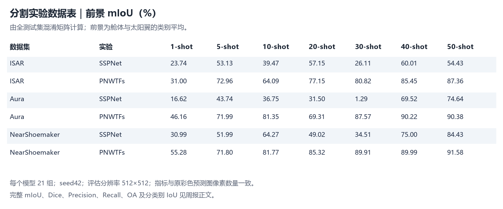

### 各数据集最佳档位

| 数据集 | 实验 | 最高前景mIoU对应档位 | 前景mIoU | 前景Dice |
| --- | --- | --- | --- | --- |
| ISAR | SSPNet | 40-shot | 60.01 | 74.50 |
| ISAR | PNWTFs | 50-shot | 87.36 | 93.24 |
| Aura | SSPNet | 50-shot | 74.64 | 85.42 |
| Aura | PNWTFs | 50-shot | 90.38 | 94.94 |
| NearShoemaker | SSPNet | 50-shot | 84.43 | 91.54 |
| NearShoemaker | PNWTFs | 50-shot | 91.58 | 95.60 |

这里的“最佳”仅是已完成七档测试结果中的最高值，不是用测试集重新选择训练检查点。

## 结果分析

### SSPNet：30-shot测试结果明显退化，Aura最突出

SSPNet在ISAR上的前景mIoU从20-shot的 **57.15%** 降至30-shot的 **26.11%**，40-shot回升到60.01%；30-shot舱体IoU为48.51%，太阳翼IoU仅3.71%。该档位有14/38张图的预测前景超过半张图，与大面积绿色覆盖的可视化现象一致。

Aura的30-shot前景mIoU仅 **1.29%**，前景Dice为 **2.52%**，OA为 **9.24%**；舱体IoU为0，太阳翼IoU为2.59%。整组预测没有舱体像素，93.16%的像素被预测为太阳翼。混淆矩阵进一步显示：5,865,050个真实背景像素及全部82,676个真实舱体像素被分到太阳翼类别。太阳翼Recall虽为100%，但Precision仅2.59%，说明这是大面积误报，不能把高召回率理解为分割效果好。

NearShoemaker的30-shot前景mIoU为34.51%，低于20-shot的49.02%和40-shot的75.00%；其舱体IoU仅11.22%，太阳翼IoU为57.79%，提示三个数据集上的退化表现并不完全相同。50-shot时，SSPNet在ISAR、Aura、NearShoemaker上的前景mIoU分别为54.43%、74.64%、84.43%。

### 训练日志复核：测试退化已确认，原因仍需定位

Aura的30-shot日志记录到第100轮，监督损失由0.874944降至0.343875，一致性损失末轮为0.323607。末轮有标注训练批次的平均预测类别分布为 **背景96.14%、舱体1.42%、太阳翼2.45%**；伪标签分布为 **95.89%、1.61%、2.50%**。这些记录没有表现出测试图中“93.16%像素为太阳翼”的同等偏置。

因此，现有证据支持“最终测试输出显著退化”，还不足以认定“整个训练过程或伪标签全部塌缩”。训练日志统计发生在训练模式、训练批次及当时的参数状态下，与最终测试样本及推理模式不同。下一步应使用同一检查点、同一批样本进行训练/推理模式对照，并核查预处理、归一化状态和检查点加载；这些是排查方向，不是已经确定的原因。计划文件与完成标记签名一致，但它们本身不能替代模型权重内容核验。

### PNWTFs：中高样本效果较好，局部档位仍有波动

PNWTFs在50-shot时，三个数据集的前景mIoU分别达到 **87.36%、90.38%、91.58%**，前景Dice分别为 **93.24%、94.94%、95.60%**。在本次21个同数据集、同shot档位的对照中，PNWTFs的前景mIoU均高于SSPNet；50-shot差值分别为32.93、15.74、7.15个百分点。

样本数量增加并未带来完全单调的改善：ISAR从5-shot的72.96%降至10-shot的64.09%，Aura从10-shot的81.35%降至20-shot的69.31%。NearShoemaker则从1-shot的55.28%逐档提高到50-shot的91.58%。这些结论仅针对本次seed42及当前实现；SSPNet额外使用无标注训练数据，比较时需同时说明训练条件。

## 测试结果展示

以下按数据集列出全部七档结果，每档先列整组分割精度，再展示固定四个测试样本。图中左侧为 **SSPNet**，右侧为 **PNWTFs**。同一数据集跨方法、跨shot使用相同样本，黑色为背景、红色为舱体、绿色为太阳翼。拼图只展示预测标签；表格统计整个测试集，不是只统计图中的四张样本。

### ISAR

测试集：38张；固定展示样本：1016、1291、2566、2576。

#### 1-shot

| 实验 | 全类mIoU | 前景mIoU | 前景Dice | 前景Precision | 前景Recall | OA | 舱体IoU | 太阳翼IoU |
| --- | --- | --- | --- | --- | --- | --- | --- | --- |
| SSPNet | 20.02 | 23.74 | 33.18 | 28.07 | 77.85 | 15.09 | 45.57 | 1.92 |
| PNWTFs | 53.54 | 31.00 | 40.00 | 64.21 | 49.67 | 97.72 | 59.03 | 2.97 |

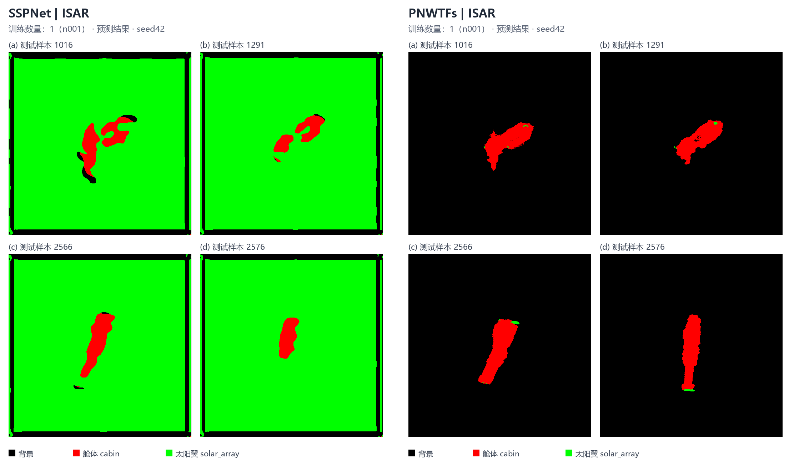

#### 5-shot

| 实验 | 全类mIoU | 前景mIoU | 前景Dice | 前景Precision | 前景Recall | OA | 舱体IoU | 太阳翼IoU |
| --- | --- | --- | --- | --- | --- | --- | --- | --- |
| SSPNet | 68.07 | 53.13 | 68.58 | 61.10 | 78.68 | 97.64 | 65.17 | 41.09 |
| PNWTFs | 81.77 | 72.96 | 84.27 | 82.41 | 86.85 | 99.10 | 77.92 | 67.99 |

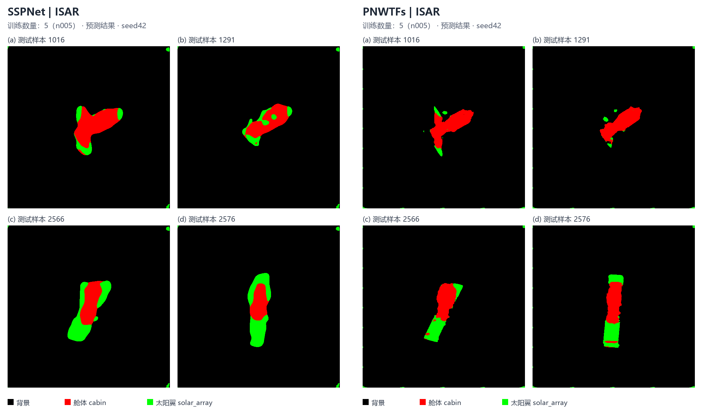

#### 10-shot

| 实验 | 全类mIoU | 前景mIoU | 前景Dice | 前景Precision | 前景Recall | OA | 舱体IoU | 太阳翼IoU |
| --- | --- | --- | --- | --- | --- | --- | --- | --- |
| SSPNet | 57.26 | 39.47 | 53.36 | 43.21 | 82.64 | 92.57 | 60.20 | 18.74 |
| PNWTFs | 75.85 | 64.09 | 77.87 | 80.17 | 78.30 | 98.87 | 71.36 | 56.81 |

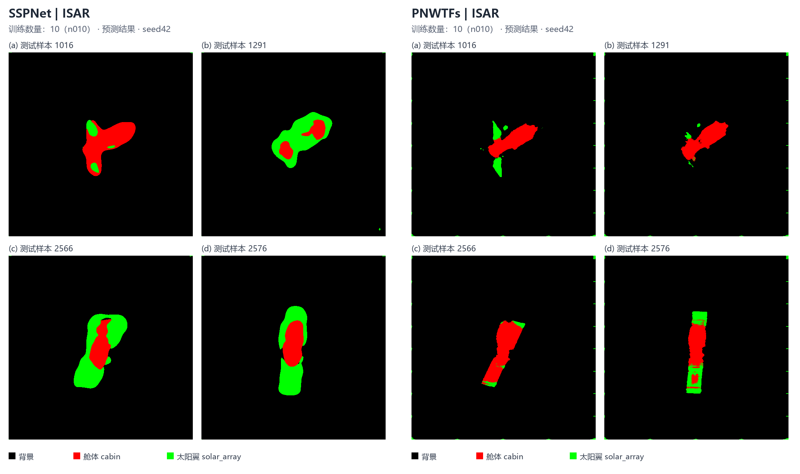

#### 20-shot

| 实验 | 全类mIoU | 前景mIoU | 前景Dice | 前景Precision | 前景Recall | OA | 舱体IoU | 太阳翼IoU |
| --- | --- | --- | --- | --- | --- | --- | --- | --- |
| SSPNet | 71.01 | 57.15 | 72.39 | 69.40 | 76.33 | 98.29 | 65.26 | 49.03 |
| PNWTFs | 84.65 | 77.15 | 87.07 | 89.05 | 86.90 | 99.34 | 80.15 | 74.16 |

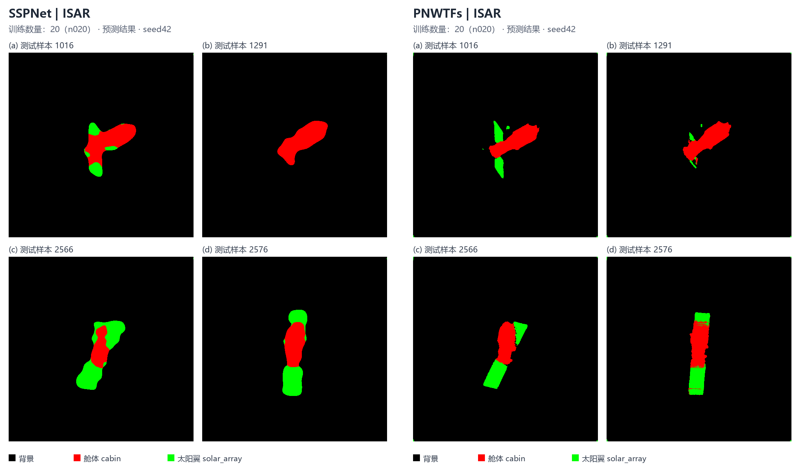

#### 30-shot

| 实验 | 全类mIoU | 前景mIoU | 前景Dice | 前景Precision | 前景Recall | OA | 舱体IoU | 太阳翼IoU |
| --- | --- | --- | --- | --- | --- | --- | --- | --- |
| SSPNet | 39.15 | 26.11 | 36.24 | 26.57 | 79.95 | 65.81 | 48.51 | 3.71 |
| PNWTFs | 87.10 | 80.82 | 89.36 | 91.45 | 88.42 | 99.43 | 84.03 | 77.61 |

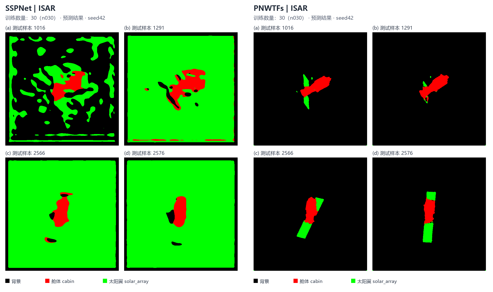

#### 40-shot

| 实验 | 全类mIoU | 前景mIoU | 前景Dice | 前景Precision | 前景Recall | OA | 舱体IoU | 太阳翼IoU |
| --- | --- | --- | --- | --- | --- | --- | --- | --- |
| SSPNet | 73.04 | 60.01 | 74.50 | 83.05 | 71.45 | 98.68 | 70.21 | 49.82 |
| PNWTFs | 90.20 | 85.45 | 92.14 | 92.42 | 92.20 | 99.55 | 87.70 | 83.19 |

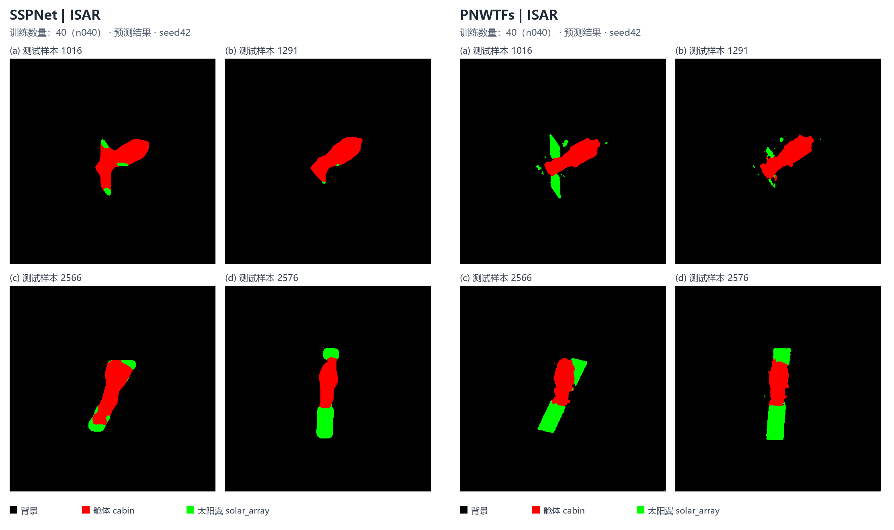

#### 50-shot

| 实验 | 全类mIoU | 前景mIoU | 前景Dice | 前景Precision | 前景Recall | OA | 舱体IoU | 太阳翼IoU |
| --- | --- | --- | --- | --- | --- | --- | --- | --- |
| SSPNet | 69.03 | 54.43 | 69.70 | 60.39 | 82.42 | 97.76 | 66.41 | 42.44 |
| PNWTFs | 91.47 | 87.36 | 93.24 | 94.65 | 92.06 | 99.60 | 89.08 | 85.64 |

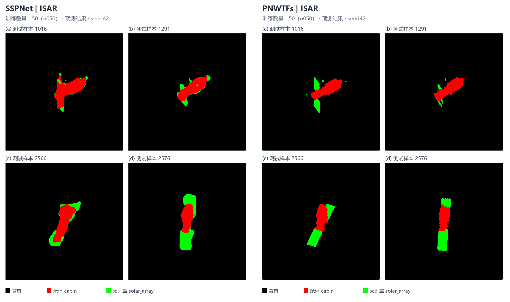

### Aura

测试集：25张；固定展示样本：1025、1255、2920、955。

#### 1-shot

| 实验 | 全类mIoU | 前景mIoU | 前景Dice | 前景Precision | 前景Recall | OA | 舱体IoU | 太阳翼IoU |
| --- | --- | --- | --- | --- | --- | --- | --- | --- |
| SSPNet | 42.71 | 16.62 | 25.51 | 17.45 | 49.26 | 93.79 | 1.34 | 31.90 |
| PNWTFs | 63.84 | 46.16 | 63.04 | 75.29 | 66.49 | 98.34 | 50.50 | 41.81 |

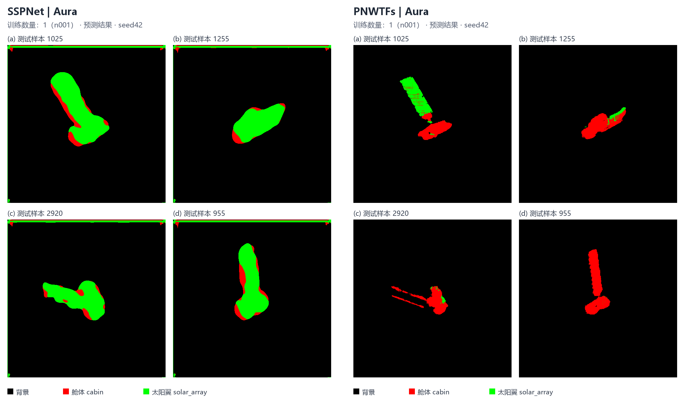

#### 5-shot

| 实验 | 全类mIoU | 前景mIoU | 前景Dice | 前景Precision | 前景Recall | OA | 舱体IoU | 太阳翼IoU |
| --- | --- | --- | --- | --- | --- | --- | --- | --- |
| SSPNet | 62.01 | 43.74 | 60.32 | 59.83 | 64.98 | 97.85 | 34.78 | 52.70 |
| PNWTFs | 81.21 | 71.99 | 83.61 | 81.77 | 88.03 | 99.25 | 66.68 | 77.30 |

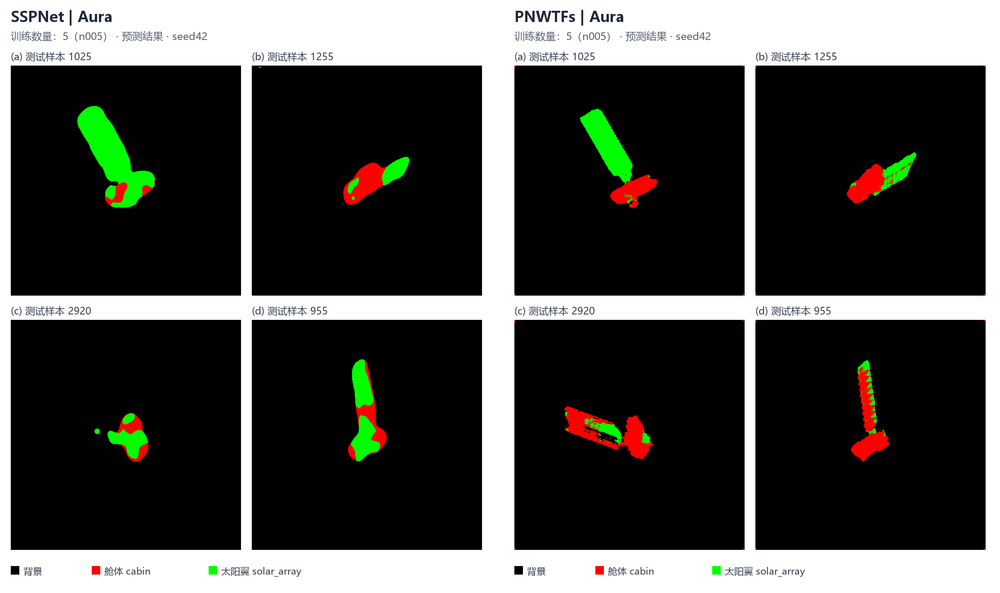

#### 10-shot

| 实验 | 全类mIoU | 前景mIoU | 前景Dice | 前景Precision | 前景Recall | OA | 舱体IoU | 太阳翼IoU |
| --- | --- | --- | --- | --- | --- | --- | --- | --- |
| SSPNet | 57.22 | 36.75 | 52.61 | 56.39 | 63.56 | 97.30 | 24.73 | 48.78 |
| PNWTFs | 87.47 | 81.35 | 89.67 | 89.40 | 90.25 | 99.51 | 77.54 | 85.16 |

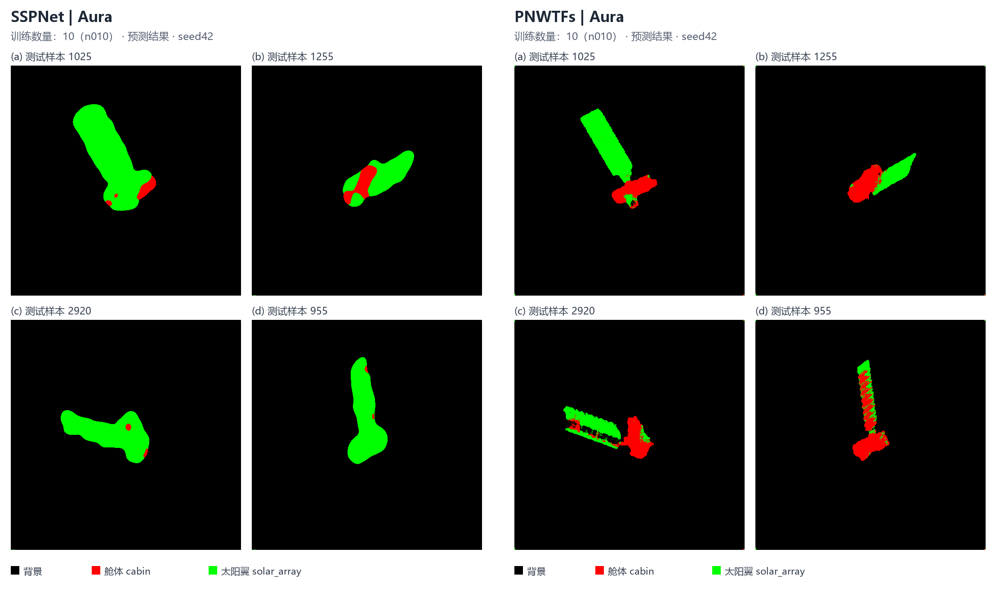

#### 20-shot

| 实验 | 全类mIoU | 前景mIoU | 前景Dice | 前景Precision | 前景Recall | OA | 舱体IoU | 太阳翼IoU |
| --- | --- | --- | --- | --- | --- | --- | --- | --- |
| SSPNet | 51.43 | 31.50 | 47.05 | 32.60 | 89.44 | 91.21 | 41.36 | 21.64 |
| PNWTFs | 79.32 | 69.31 | 81.87 | 76.60 | 88.75 | 98.98 | 69.53 | 69.09 |

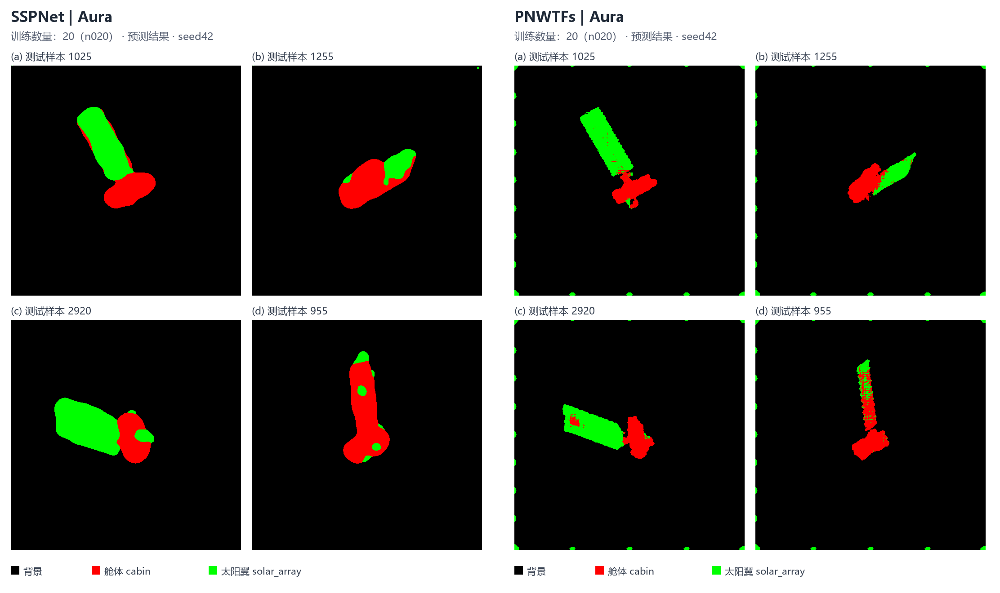

#### 30-shot

| 实验 | 全类mIoU | 前景mIoU | 前景Dice | 前景Precision | 前景Recall | OA | 舱体IoU | 太阳翼IoU |
| --- | --- | --- | --- | --- | --- | --- | --- | --- |
| SSPNet | 3.23 | 1.29 | 2.52 | 1.29 | 50.00 | 9.24 | 0.00 | 2.59 |
| PNWTFs | 91.63 | 87.57 | 93.36 | 92.61 | 94.17 | 99.65 | 85.20 | 89.94 |

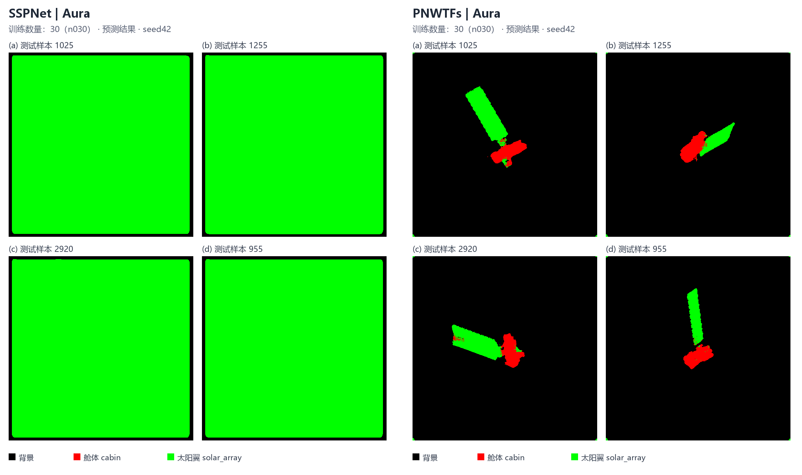

#### 40-shot

| 实验 | 全类mIoU | 前景mIoU | 前景Dice | 前景Precision | 前景Recall | OA | 舱体IoU | 太阳翼IoU |
| --- | --- | --- | --- | --- | --- | --- | --- | --- |
| SSPNet | 79.45 | 69.52 | 81.90 | 87.32 | 77.49 | 99.09 | 64.24 | 74.79 |
| PNWTFs | 93.40 | 90.22 | 94.85 | 94.25 | 95.51 | 99.70 | 88.63 | 91.81 |

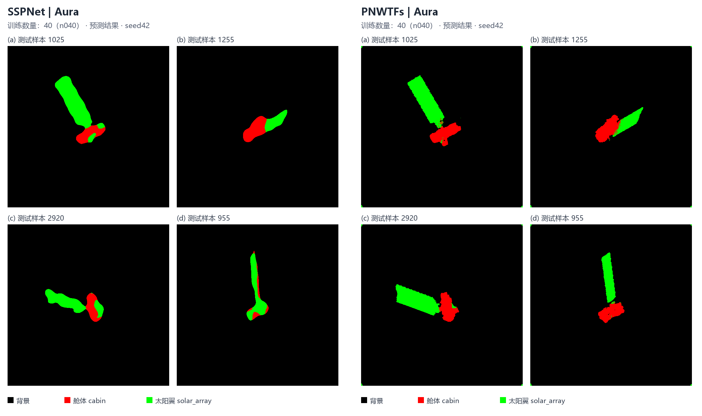

#### 50-shot

| 实验 | 全类mIoU | 前景mIoU | 前景Dice | 前景Precision | 前景Recall | OA | 舱体IoU | 太阳翼IoU |
| --- | --- | --- | --- | --- | --- | --- | --- | --- |
| SSPNet | 82.91 | 74.64 | 85.42 | 87.44 | 84.30 | 99.24 | 70.76 | 78.51 |
| PNWTFs | 93.51 | 90.38 | 94.94 | 94.37 | 95.53 | 99.72 | 88.56 | 92.20 |

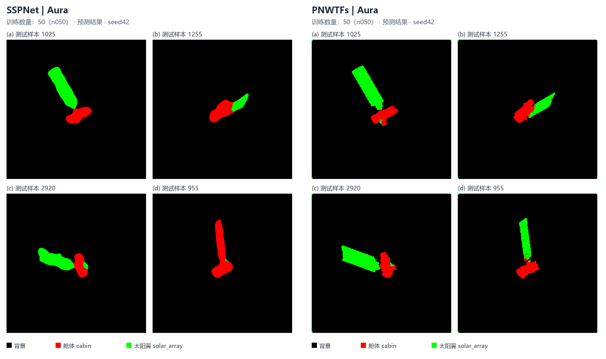

### NearShoemaker

测试集：18张；固定展示样本：1365、1580、2090、5940。

#### 1-shot

| 实验 | 全类mIoU | 前景mIoU | 前景Dice | 前景Precision | 前景Recall | OA | 舱体IoU | 太阳翼IoU |
| --- | --- | --- | --- | --- | --- | --- | --- | --- |
| SSPNet | 35.67 | 30.99 | 40.56 | 31.53 | 91.46 | 47.02 | 57.94 | 4.04 |
| PNWTFs | 69.92 | 55.28 | 70.83 | 78.96 | 72.61 | 98.41 | 63.59 | 46.97 |

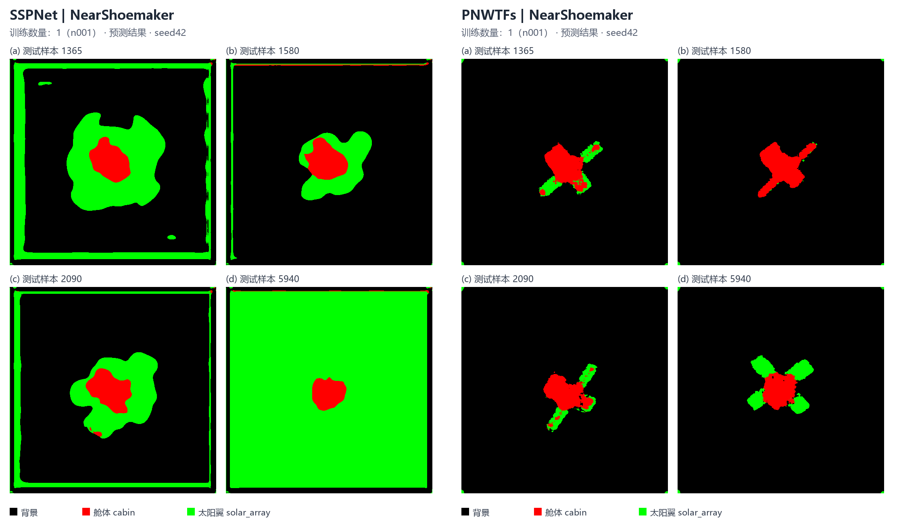

#### 5-shot

| 实验 | 全类mIoU | 前景mIoU | 前景Dice | 前景Precision | 前景Recall | OA | 舱体IoU | 太阳翼IoU |
| --- | --- | --- | --- | --- | --- | --- | --- | --- |
| SSPNet | 67.38 | 51.99 | 68.39 | 65.23 | 75.75 | 97.49 | 54.10 | 49.89 |
| PNWTFs | 80.90 | 71.80 | 83.40 | 80.32 | 87.13 | 98.79 | 78.54 | 65.05 |

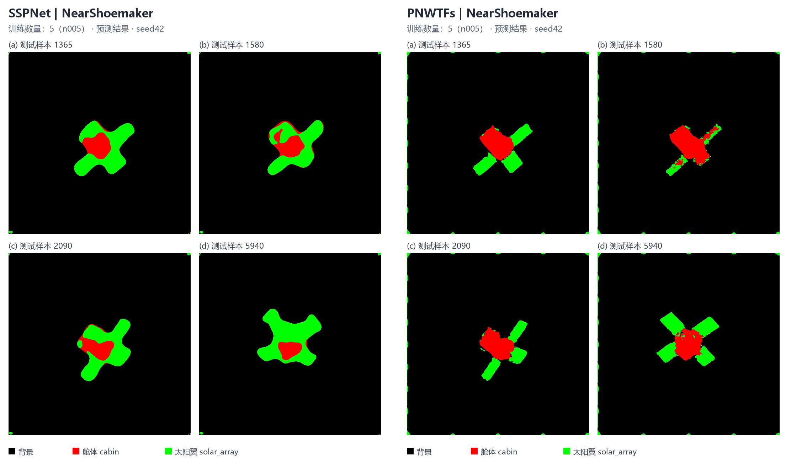

#### 10-shot

| 实验 | 全类mIoU | 前景mIoU | 前景Dice | 前景Precision | 前景Recall | OA | 舱体IoU | 太阳翼IoU |
| --- | --- | --- | --- | --- | --- | --- | --- | --- |
| SSPNet | 75.60 | 64.27 | 77.95 | 70.10 | 88.85 | 97.96 | 72.47 | 56.07 |
| PNWTFs | 87.70 | 81.77 | 89.97 | 90.31 | 90.04 | 99.35 | 82.62 | 80.92 |

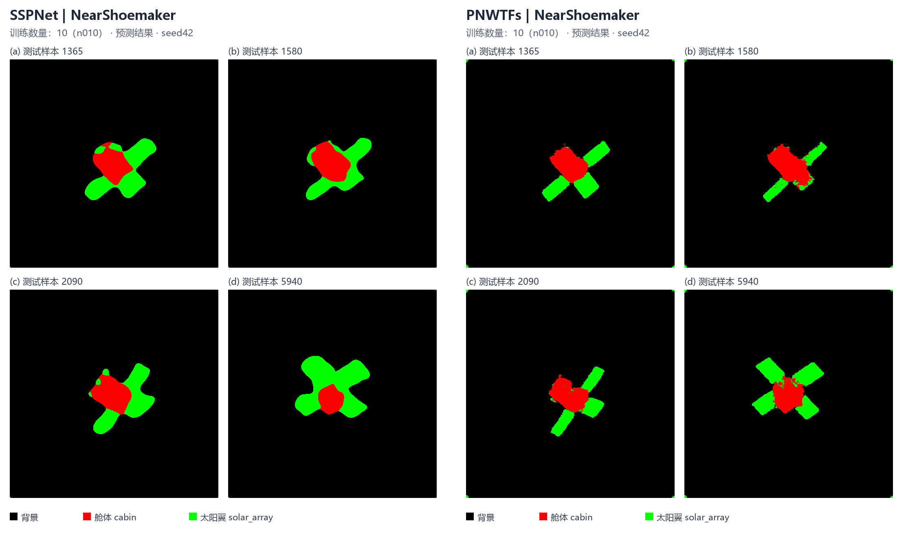

#### 20-shot

| 实验 | 全类mIoU | 前景mIoU | 前景Dice | 前景Precision | 前景Recall | OA | 舱体IoU | 太阳翼IoU |
| --- | --- | --- | --- | --- | --- | --- | --- | --- |
| SSPNet | 64.03 | 49.02 | 61.60 | 50.97 | 83.14 | 93.95 | 74.92 | 23.11 |
| PNWTFs | 90.06 | 85.32 | 92.07 | 90.39 | 93.82 | 99.42 | 87.00 | 83.64 |

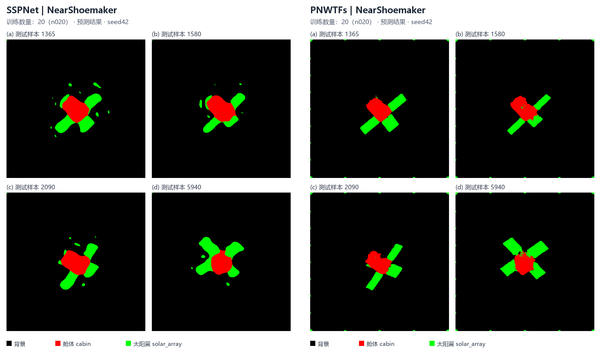

#### 30-shot

| 实验 | 全类mIoU | 前景mIoU | 前景Dice | 前景Precision | 前景Recall | OA | 舱体IoU | 太阳翼IoU |
| --- | --- | --- | --- | --- | --- | --- | --- | --- |
| SSPNet | 51.51 | 34.51 | 46.71 | 36.72 | 88.65 | 85.84 | 11.22 | 57.79 |
| PNWTFs | 93.16 | 89.91 | 94.68 | 93.55 | 95.84 | 99.60 | 90.99 | 88.82 |

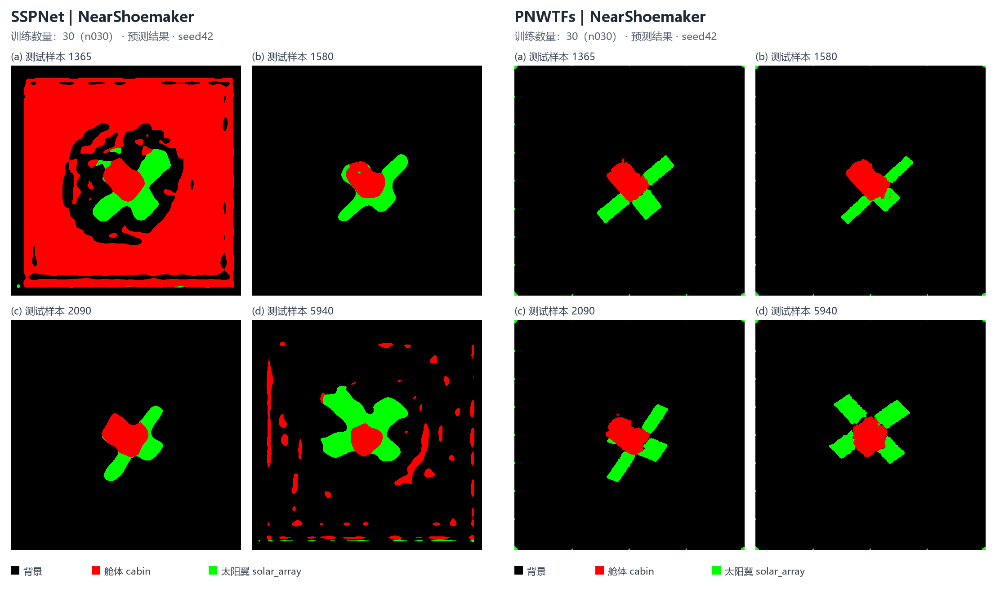

#### 40-shot

| 实验 | 全类mIoU | 前景mIoU | 前景Dice | 前景Precision | 前景Recall | OA | 舱体IoU | 太阳翼IoU |
| --- | --- | --- | --- | --- | --- | --- | --- | --- |
| SSPNet | 83.06 | 75.00 | 85.71 | 83.14 | 88.62 | 98.95 | 75.78 | 74.23 |
| PNWTFs | 93.22 | 89.99 | 94.73 | 93.53 | 95.96 | 99.60 | 91.44 | 88.55 |

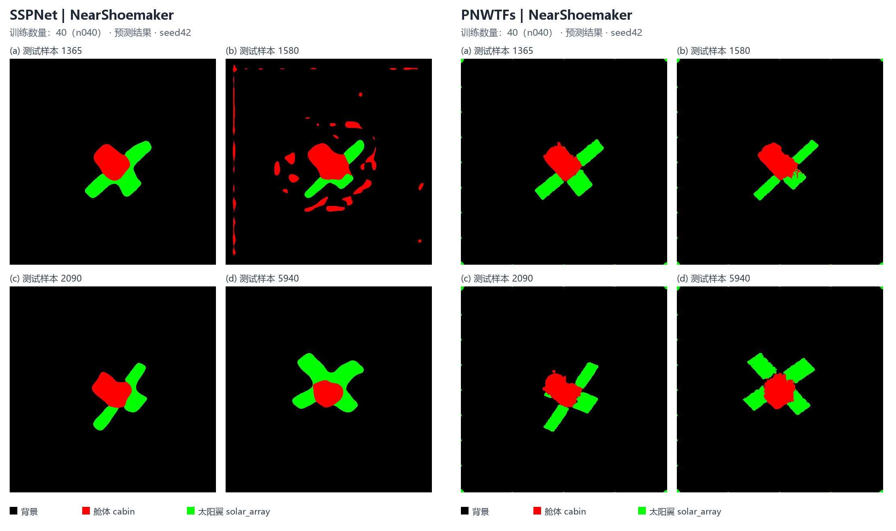

#### 50-shot

| 实验 | 全类mIoU | 前景mIoU | 前景Dice | 前景Precision | 前景Recall | OA | 舱体IoU | 太阳翼IoU |
| --- | --- | --- | --- | --- | --- | --- | --- | --- |
| SSPNet | 89.43 | 84.43 | 91.54 | 94.01 | 89.26 | 99.36 | 86.82 | 82.04 |
| PNWTFs | 94.31 | 91.58 | 95.60 | 95.06 | 96.20 | 99.70 | 91.29 | 91.87 |

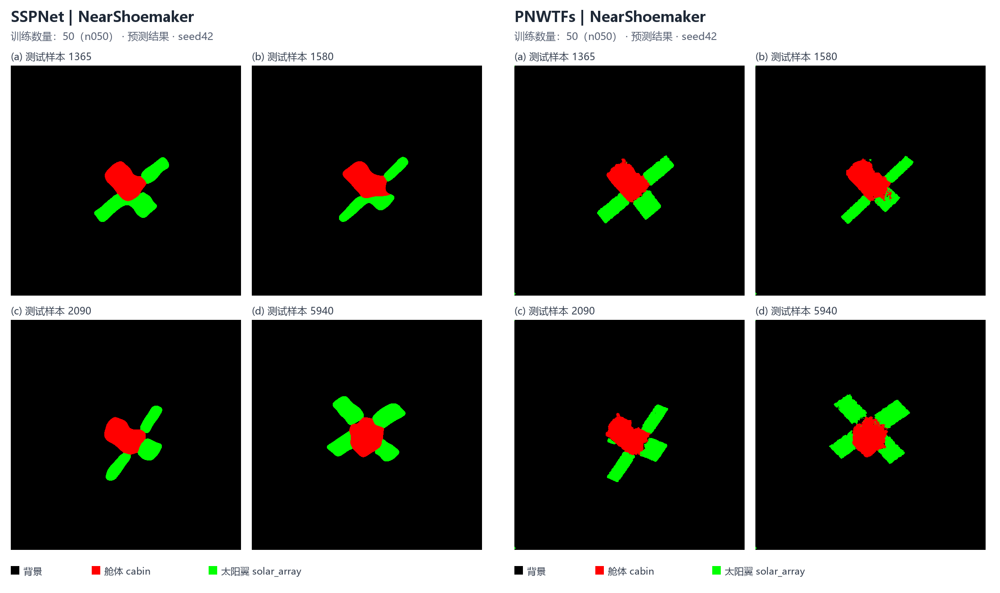

