# 周报（SCGN与FF_UKAN分割实验）

近期围绕空间目标的舱体与太阳翼分割，完成实验04（SCGN）与实验05（FF_UKAN）在ISAR、Aura、NearShoemaker三个数据集上的结果汇总。训练样本数量为1、5、10、20、30、40、50，共42组实验、1134张预测图。本次已补齐各组分割精度指标，完成混淆矩阵复算、训练记录核对和固定样本可视化整理。

## 分割实验结果

公共设置为 **seed42、输入及评估512×512**，三个数据集测试集分别为38、25、18张。1/5/10/20-shot训练预算为50个epoch，30/40/50-shot为100个epoch，使用最终检查点`last.pt`。同数据集、同shot下，各方法的训练/测试子集签名、分辨率与epoch预算一致。

SCGN与FF_UKAN的计划版本均为`corrected_reconstruction_fixed_budget`。SCGN附有`speed345-20261018-1`加速记录，训练与评估精度为BF16，损失计算为FP32；指标按本次实际运行报告。SCGN按迭代间隔写训练历史，CSV行数不等于epoch数；各组末条记录的epoch均达到计划预算。

以下指标单位均为 **%**，以整个测试集的累计混淆矩阵计算，再按类别取平均。**前景mIoU、Dice、Precision、Recall只平均舱体和太阳翼；全类mIoU包含背景；OA为所有测试像素的总体准确率。** 数值保留两位小数。所有结果均来自本次日志，不沿用10.13周报的旧指标。

### 不同训练数量的前景mIoU

| 数据集 | 实验 | 1-shot | 5-shot | 10-shot | 20-shot | 30-shot | 40-shot | 50-shot |
| --- | --- | --- | --- | --- | --- | --- | --- | --- |
| ISAR | SCGN | 29.73 | 58.09 | 69.77 | 61.93 | 76.66 | 63.85 | 81.71 |
| ISAR | FF_UKAN | 1.98 | 70.50 | 82.26 | 85.79 | 66.74 | 78.84 | 66.35 |
| Aura | SCGN | 29.13 | 76.90 | 78.86 | 83.42 | 87.43 | 89.14 | 89.52 |
| Aura | FF_UKAN | 6.20 | 77.20 | 84.84 | 87.35 | 89.19 | 89.93 | 93.34 |
| NearShoemaker | SCGN | 22.09 | 78.14 | 83.11 | 87.54 | 89.08 | 90.31 | 89.56 |
| NearShoemaker | FF_UKAN | 15.37 | 72.52 | 60.54 | 86.50 | 91.57 | 91.36 | 93.11 |

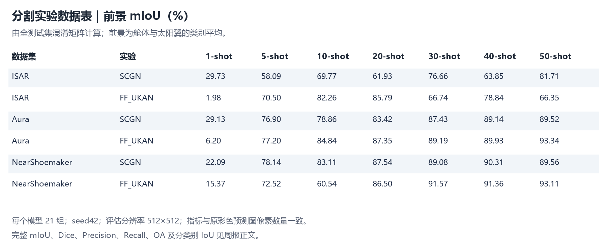

### 各数据集最佳档位

| 数据集 | 实验 | 最高前景mIoU对应档位 | 前景mIoU | 前景Dice |
| --- | --- | --- | --- | --- |
| ISAR | SCGN | 50-shot | 81.71 | 89.87 |
| ISAR | FF_UKAN | 20-shot | 85.79 | 92.31 |
| Aura | SCGN | 50-shot | 89.52 | 94.45 |
| Aura | FF_UKAN | 50-shot | 93.34 | 96.55 |
| NearShoemaker | SCGN | 40-shot | 90.31 | 94.91 |
| NearShoemaker | FF_UKAN | 50-shot | 93.11 | 96.43 |

这里的“最佳”仅是已完成七档测试结果中的最高值，不是用测试集重新选择训练检查点。

## 结果分析

### SCGN：Aura整体提升，ISAR存在中间档位回落

SCGN在Aura上的前景mIoU从1-shot的 **29.13%** 随档位增加提高到50-shot的 **89.52%**，50-shot前景Dice为94.45%。NearShoemaker在40-shot达到最高的 **90.31%**，50-shot略降至89.56%。

ISAR在50-shot达到本方法最高前景mIoU **81.71%**，但20-shot为61.93%，低于10-shot的69.77%；40-shot为63.85%，低于30-shot的76.66%。20-shot和40-shot的大面积前景覆盖均出现在测试样本2656，预测前景分别占该图73.00%和83.35%。这与对应档位整体指标回落同时出现，但缺少逐图指标，不能把全部下降归因于这一张图。

### FF_UKAN：Aura和NearShoemaker高样本结果较好，ISAR波动明显

FF_UKAN在50-shot时，Aura与NearShoemaker的前景mIoU分别为 **93.34%和93.11%**，前景Dice分别为 **96.55%和96.43%**。相对同档SCGN，前景mIoU分别高3.82和3.55个百分点。

ISAR在20-shot达到85.79%，30-shot降为66.74%，40-shot回升至78.84%，50-shot再次降至66.35%。50-shot舱体IoU仍有 **91.43%**，太阳翼IoU仅 **41.26%**；前景Precision为68.30%，Recall为94.30%，结合预测图说明该档位存在明显误报。样本2656在30-shot与50-shot的前景覆盖分别达到91.50%和94.39%，需重点复核其逐像素错误。

NearShoemaker从5-shot的72.52%降至10-shot的60.54%，随后20-shot回升到86.50%。10-shot的样本1580为全背景输出，是该组唯一的全背景图，需与真实标签逐图对照；目前不能量化这张图对整组下降的具体贡献。

### 两种方法的当前比较与实验条件

50-shot时，SCGN在ISAR上的前景mIoU比FF_UKAN高15.36个百分点；FF_UKAN在Aura和NearShoemaker上更高。1-shot时，SCGN在三个数据集上均高于FF_UKAN，因此不能用单一档位给出不加条件的总体优劣判断。

SCGN的加速记录注明本次训练与评估使用 **BF16**，损失计算为FP32，并启用训练输入缓存；记录同时说明数值精度与数据加载方式变化可能影响结果。此处如实报告本次运行的指标，不将其视为未经加速的基线复现结果。训练计划的样本划分、分辨率和epoch预算已对齐，但不同模型的实现与数值执行条件仍需在比较中保留说明。

## 测试结果展示

以下按数据集列出全部七档结果，每档先列整组分割精度，再展示固定四个测试样本。图中左侧为 **SCGN**，右侧为 **FF_UKAN**。同一数据集跨方法、跨shot使用相同样本，黑色为背景、红色为舱体、绿色为太阳翼。拼图只展示预测标签；表格统计整个测试集，不是只统计图中的四张样本。

### ISAR

测试集：38张；固定展示样本：1016、1291、2566、2576。

#### 1-shot

| 实验 | 全类mIoU | 前景mIoU | 前景Dice | 前景Precision | 前景Recall | OA | 舱体IoU | 太阳翼IoU |
| --- | --- | --- | --- | --- | --- | --- | --- | --- |
| SCGN | 52.30 | 29.73 | 37.65 | 50.54 | 31.02 | 97.27 | 58.86 | 0.60 |
| FF_UKAN | 33.66 | 1.98 | 3.85 | 48.54 | 2.11 | 96.23 | 3.36 | 0.60 |

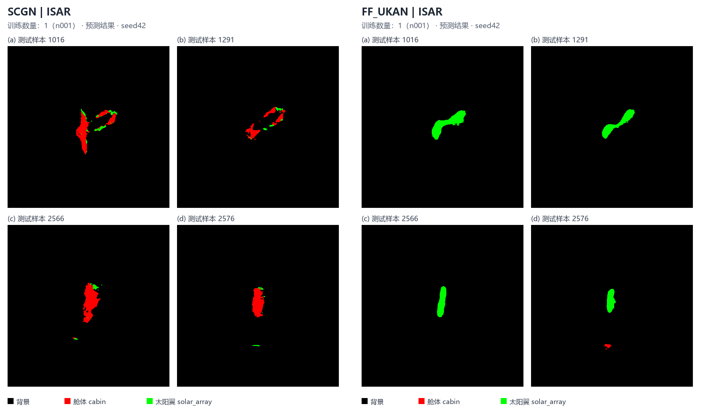

#### 5-shot

| 实验 | 全类mIoU | 前景mIoU | 前景Dice | 前景Precision | 前景Recall | OA | 舱体IoU | 太阳翼IoU |
| --- | --- | --- | --- | --- | --- | --- | --- | --- |
| SCGN | 71.66 | 58.09 | 71.55 | 84.55 | 66.15 | 98.51 | 77.54 | 38.65 |
| FF_UKAN | 79.96 | 70.50 | 82.23 | 76.67 | 89.35 | 98.67 | 81.28 | 59.72 |

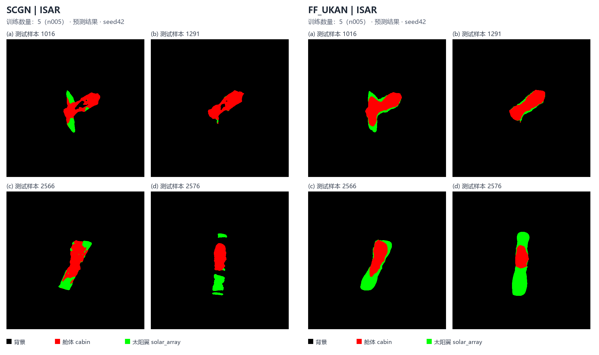

#### 10-shot

| 实验 | 全类mIoU | 前景mIoU | 前景Dice | 前景Precision | 前景Recall | OA | 舱体IoU | 太阳翼IoU |
| --- | --- | --- | --- | --- | --- | --- | --- | --- |
| SCGN | 79.60 | 69.77 | 81.85 | 89.09 | 78.29 | 99.01 | 78.92 | 60.61 |
| FF_UKAN | 88.01 | 82.26 | 90.22 | 91.32 | 89.18 | 99.38 | 86.11 | 78.42 |

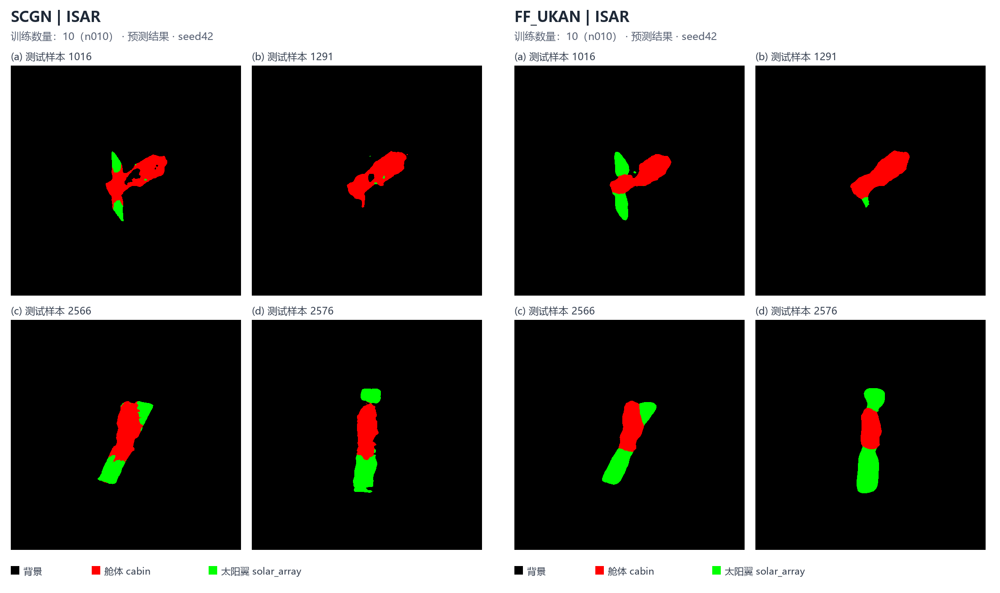

#### 20-shot

| 实验 | 全类mIoU | 前景mIoU | 前景Dice | 前景Precision | 前景Recall | OA | 舱体IoU | 太阳翼IoU |
| --- | --- | --- | --- | --- | --- | --- | --- | --- |
| SCGN | 73.84 | 61.93 | 74.23 | 66.51 | 86.45 | 97.52 | 83.65 | 40.22 |
| FF_UKAN | 90.39 | 85.79 | 92.31 | 93.97 | 90.79 | 99.52 | 89.49 | 82.09 |

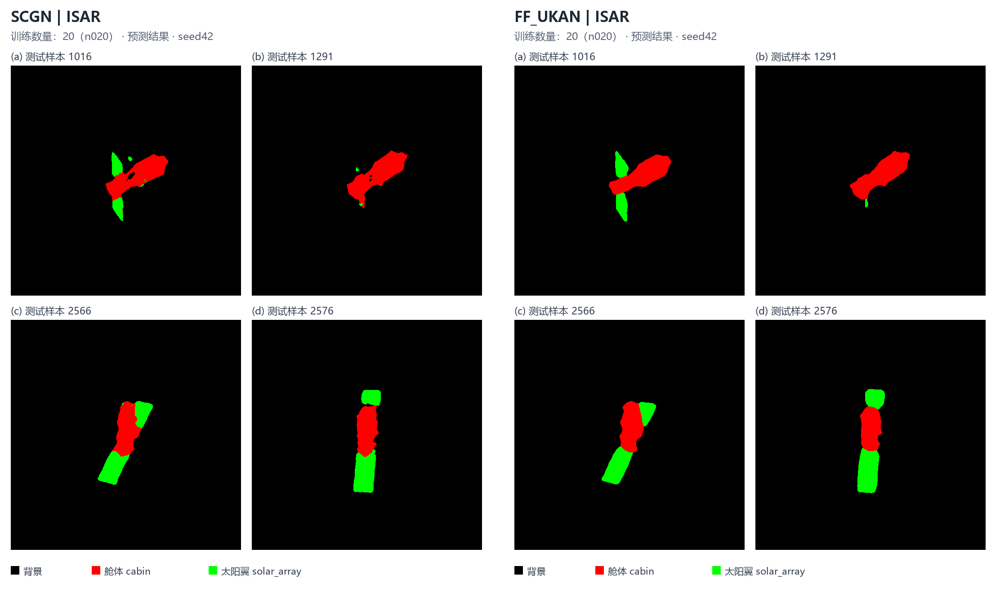

#### 30-shot

| 实验 | 全类mIoU | 前景mIoU | 前景Dice | 前景Precision | 前景Recall | OA | 舱体IoU | 太阳翼IoU |
| --- | --- | --- | --- | --- | --- | --- | --- | --- |
| SCGN | 84.25 | 76.66 | 86.65 | 88.55 | 85.58 | 99.22 | 82.81 | 70.50 |
| FF_UKAN | 76.94 | 66.74 | 77.33 | 69.37 | 93.82 | 97.36 | 91.55 | 41.93 |

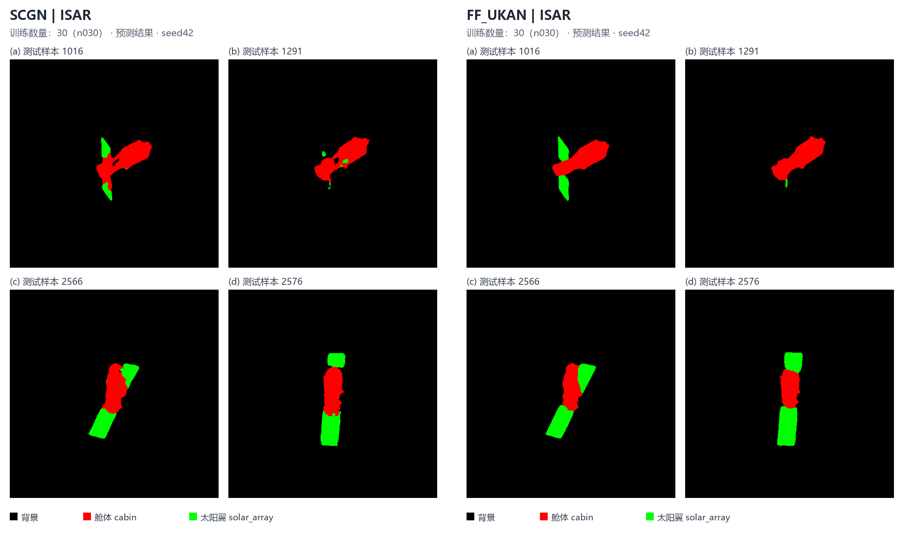

#### 40-shot

| 实验 | 全类mIoU | 前景mIoU | 前景Dice | 前景Precision | 前景Recall | OA | 舱体IoU | 太阳翼IoU |
| --- | --- | --- | --- | --- | --- | --- | --- | --- |
| SCGN | 75.05 | 63.85 | 75.47 | 67.34 | 90.17 | 97.40 | 86.89 | 40.80 |
| FF_UKAN | 85.55 | 78.84 | 87.53 | 82.04 | 94.45 | 98.95 | 92.27 | 65.41 |

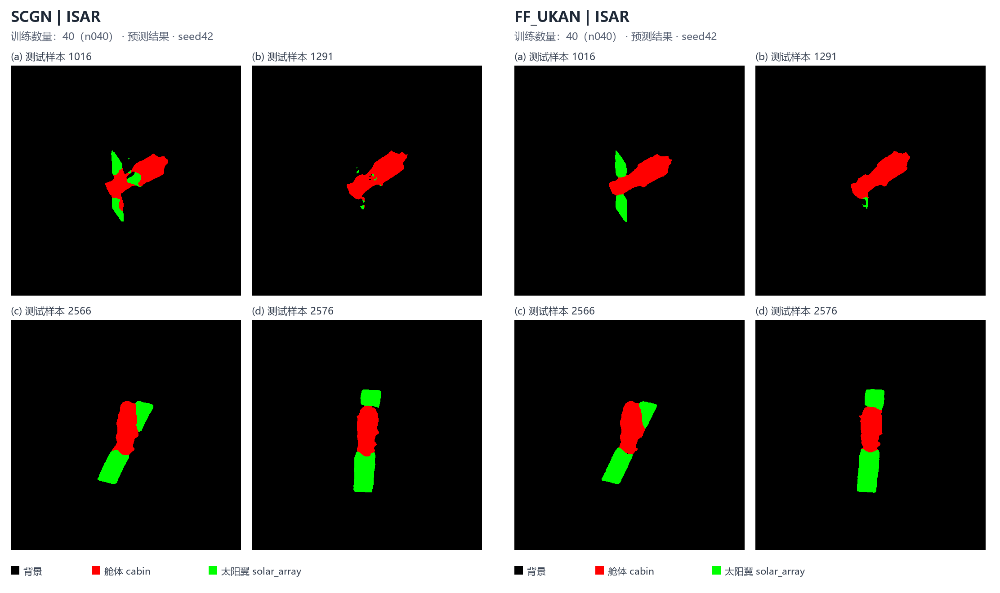

#### 50-shot

| 实验 | 全类mIoU | 前景mIoU | 前景Dice | 前景Precision | 前景Recall | OA | 舱体IoU | 太阳翼IoU |
| --- | --- | --- | --- | --- | --- | --- | --- | --- |
| SCGN | 87.66 | 81.71 | 89.87 | 91.18 | 88.96 | 99.40 | 86.02 | 77.40 |
| FF_UKAN | 76.67 | 66.35 | 76.97 | 68.30 | 94.30 | 97.32 | 91.43 | 41.26 |

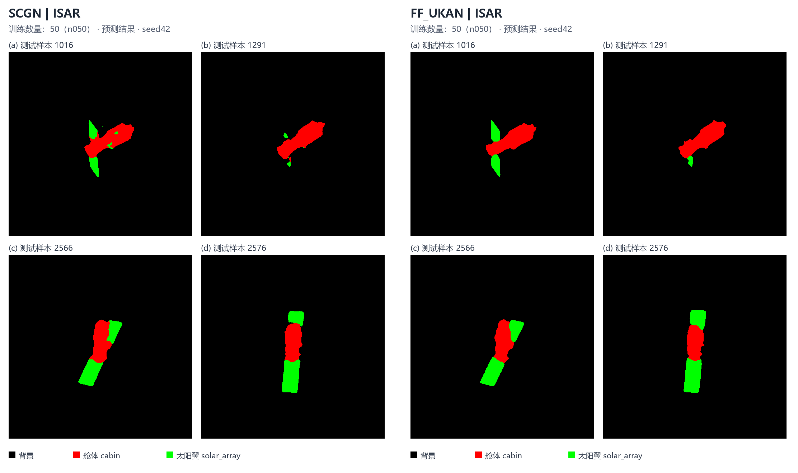

### Aura

测试集：25张；固定展示样本：1025、1255、2920、955。

#### 1-shot

| 实验 | 全类mIoU | 前景mIoU | 前景Dice | 前景Precision | 前景Recall | OA | 舱体IoU | 太阳翼IoU |
| --- | --- | --- | --- | --- | --- | --- | --- | --- |
| SCGN | 52.18 | 29.13 | 44.77 | 72.65 | 34.13 | 97.68 | 22.99 | 35.27 |
| FF_UKAN | 36.48 | 6.20 | 11.33 | 57.63 | 7.22 | 96.62 | 1.68 | 10.72 |

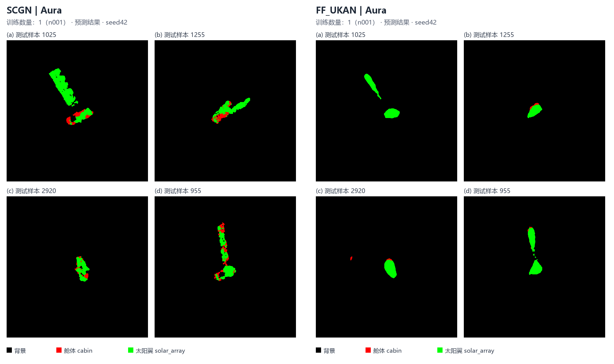

#### 5-shot

| 实验 | 全类mIoU | 前景mIoU | 前景Dice | 前景Precision | 前景Recall | OA | 舱体IoU | 太阳翼IoU |
| --- | --- | --- | --- | --- | --- | --- | --- | --- |
| SCGN | 84.45 | 76.90 | 86.89 | 88.04 | 85.96 | 99.34 | 73.20 | 80.60 |
| FF_UKAN | 84.56 | 77.20 | 87.07 | 81.50 | 94.03 | 99.18 | 73.25 | 81.15 |

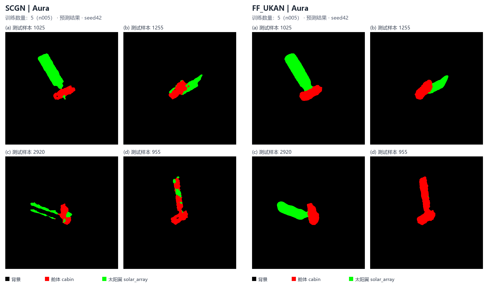

#### 10-shot

| 实验 | 全类mIoU | 前景mIoU | 前景Dice | 前景Precision | 前景Recall | OA | 舱体IoU | 太阳翼IoU |
| --- | --- | --- | --- | --- | --- | --- | --- | --- |
| SCGN | 85.77 | 78.86 | 88.15 | 89.85 | 86.75 | 99.40 | 75.85 | 81.87 |
| FF_UKAN | 89.75 | 84.84 | 91.79 | 90.77 | 92.93 | 99.50 | 82.71 | 86.98 |

#### 20-shot

| 实验 | 全类mIoU | 前景mIoU | 前景Dice | 前景Precision | 前景Recall | OA | 舱体IoU | 太阳翼IoU |
| --- | --- | --- | --- | --- | --- | --- | --- | --- |
| SCGN | 88.85 | 83.42 | 90.91 | 91.41 | 90.44 | 99.56 | 79.41 | 87.44 |
| FF_UKAN | 91.46 | 87.35 | 93.23 | 92.56 | 94.10 | 99.61 | 85.34 | 89.36 |

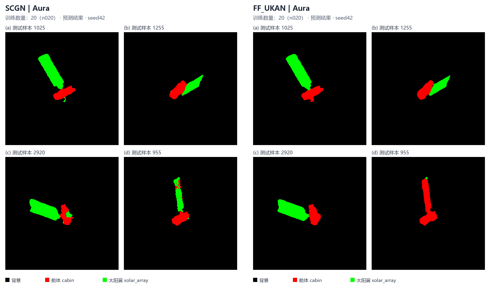

#### 30-shot

| 实验 | 全类mIoU | 前景mIoU | 前景Dice | 前景Precision | 前景Recall | OA | 舱体IoU | 太阳翼IoU |
| --- | --- | --- | --- | --- | --- | --- | --- | --- |
| SCGN | 91.54 | 87.43 | 93.27 | 93.89 | 92.65 | 99.65 | 84.41 | 90.45 |
| FF_UKAN | 92.72 | 89.19 | 94.28 | 94.09 | 94.54 | 99.69 | 87.05 | 91.34 |

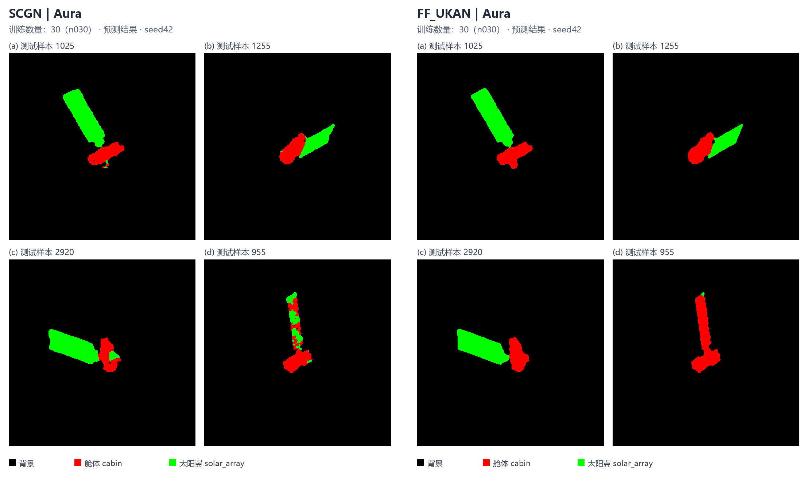

#### 40-shot

| 实验 | 全类mIoU | 前景mIoU | 前景Dice | 前景Precision | 前景Recall | OA | 舱体IoU | 太阳翼IoU |
| --- | --- | --- | --- | --- | --- | --- | --- | --- |
| SCGN | 92.68 | 89.14 | 94.24 | 94.85 | 93.63 | 99.69 | 86.62 | 91.65 |
| FF_UKAN | 93.21 | 89.93 | 94.69 | 94.12 | 95.32 | 99.71 | 87.93 | 91.92 |

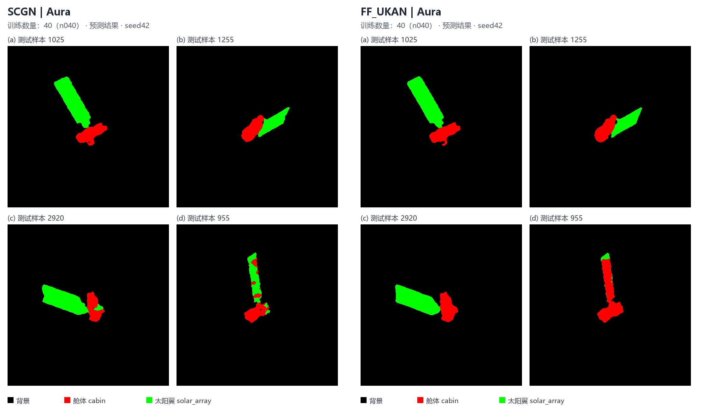

#### 50-shot

| 实验 | 全类mIoU | 前景mIoU | 前景Dice | 前景Precision | 前景Recall | OA | 舱体IoU | 太阳翼IoU |
| --- | --- | --- | --- | --- | --- | --- | --- | --- |
| SCGN | 92.93 | 89.52 | 94.45 | 94.95 | 93.96 | 99.70 | 86.91 | 92.13 |
| FF_UKAN | 95.49 | 93.34 | 96.55 | 96.41 | 96.69 | 99.78 | 91.99 | 94.69 |

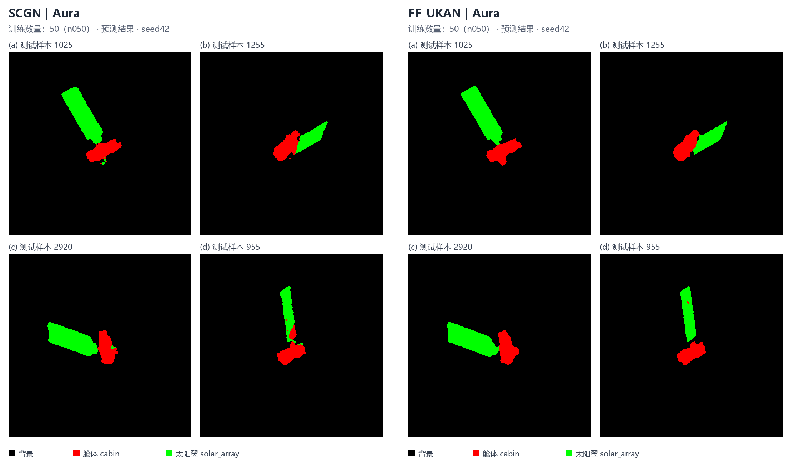

### NearShoemaker

测试集：18张；固定展示样本：1365、1580、2090、5940。

#### 1-shot

| 实验 | 全类mIoU | 前景mIoU | 前景Dice | 前景Precision | 前景Recall | OA | 舱体IoU | 太阳翼IoU |
| --- | --- | --- | --- | --- | --- | --- | --- | --- |
| SCGN | 46.87 | 22.09 | 31.26 | 82.00 | 22.55 | 96.43 | 42.93 | 1.24 |
| FF_UKAN | 42.92 | 15.37 | 23.52 | 18.46 | 32.38 | 96.26 | 0.00 | 30.75 |

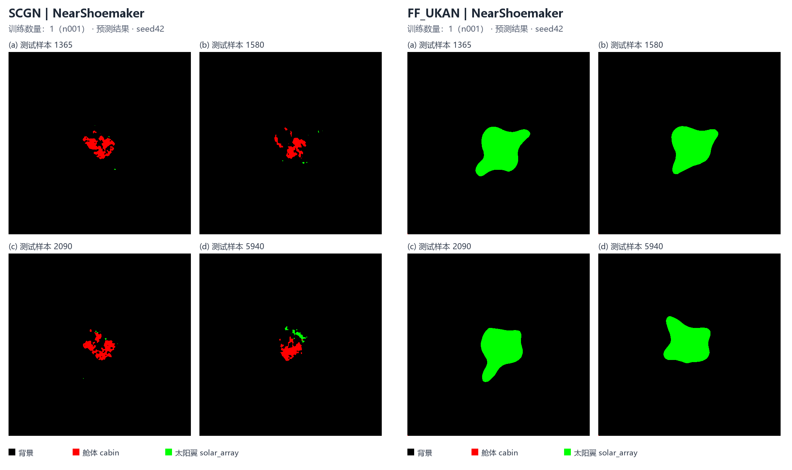

#### 5-shot

| 实验 | 全类mIoU | 前景mIoU | 前景Dice | 前景Precision | 前景Recall | OA | 舱体IoU | 太阳翼IoU |
| --- | --- | --- | --- | --- | --- | --- | --- | --- |
| SCGN | 85.24 | 78.14 | 87.70 | 87.46 | 88.60 | 99.18 | 81.12 | 75.16 |
| FF_UKAN | 81.33 | 72.52 | 84.01 | 76.95 | 92.64 | 98.71 | 76.56 | 68.48 |

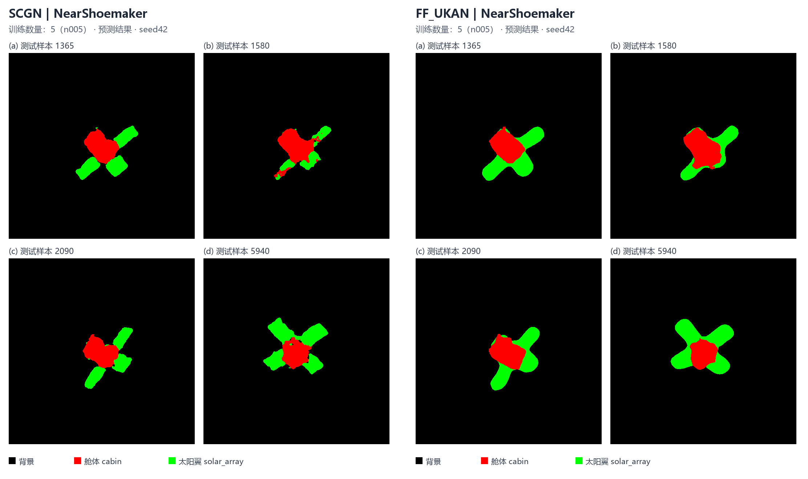

#### 10-shot

| 实验 | 全类mIoU | 前景mIoU | 前景Dice | 前景Precision | 前景Recall | OA | 舱体IoU | 太阳翼IoU |
| --- | --- | --- | --- | --- | --- | --- | --- | --- |
| SCGN | 88.55 | 83.11 | 90.76 | 93.12 | 88.68 | 99.32 | 85.25 | 80.97 |
| FF_UKAN | 73.13 | 60.54 | 75.17 | 93.47 | 63.36 | 98.31 | 53.31 | 67.77 |

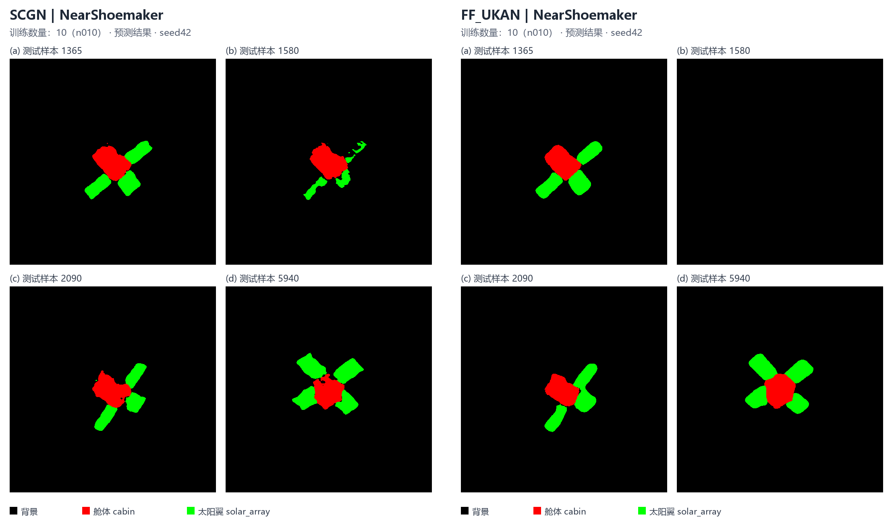

#### 20-shot

| 实验 | 全类mIoU | 前景mIoU | 前景Dice | 前景Precision | 前景Recall | OA | 舱体IoU | 太阳翼IoU |
| --- | --- | --- | --- | --- | --- | --- | --- | --- |
| SCGN | 91.57 | 87.54 | 93.35 | 93.95 | 92.82 | 99.53 | 88.13 | 86.94 |
| FF_UKAN | 90.86 | 86.50 | 92.76 | 93.74 | 91.97 | 99.48 | 87.61 | 85.40 |

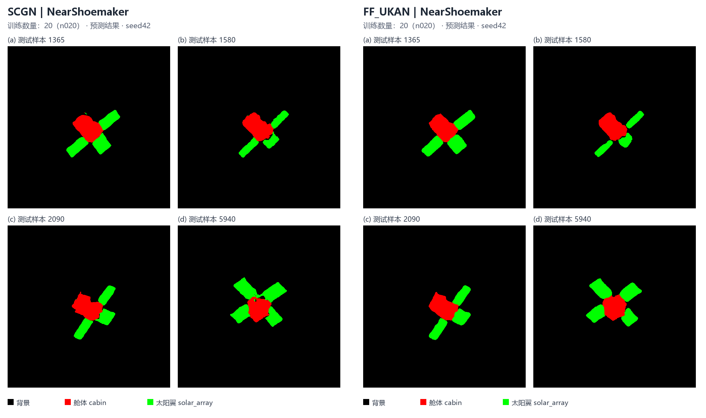

#### 30-shot

| 实验 | 全类mIoU | 前景mIoU | 前景Dice | 前景Precision | 前景Recall | OA | 舱体IoU | 太阳翼IoU |
| --- | --- | --- | --- | --- | --- | --- | --- | --- |
| SCGN | 92.62 | 89.08 | 94.23 | 94.74 | 93.73 | 99.60 | 89.13 | 89.04 |
| FF_UKAN | 94.29 | 91.57 | 95.60 | 95.49 | 95.72 | 99.69 | 91.95 | 91.18 |

#### 40-shot

| 实验 | 全类mIoU | 前景mIoU | 前景Dice | 前景Precision | 前景Recall | OA | 舱体IoU | 太阳翼IoU |
| --- | --- | --- | --- | --- | --- | --- | --- | --- |
| SCGN | 93.43 | 90.31 | 94.91 | 95.58 | 94.26 | 99.62 | 90.97 | 89.64 |
| FF_UKAN | 94.14 | 91.36 | 95.48 | 96.26 | 94.73 | 99.65 | 92.55 | 90.16 |

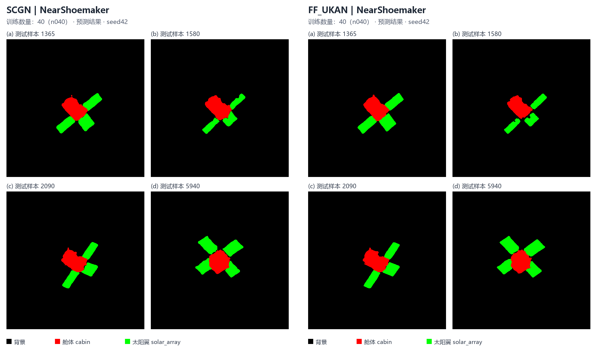

#### 50-shot

| 实验 | 全类mIoU | 前景mIoU | 前景Dice | 前景Precision | 前景Recall | OA | 舱体IoU | 太阳翼IoU |
| --- | --- | --- | --- | --- | --- | --- | --- | --- |
| SCGN | 92.92 | 89.56 | 94.49 | 96.05 | 93.00 | 99.59 | 89.73 | 89.39 |
| FF_UKAN | 95.33 | 93.11 | 96.43 | 96.35 | 96.52 | 99.73 | 93.31 | 92.90 |

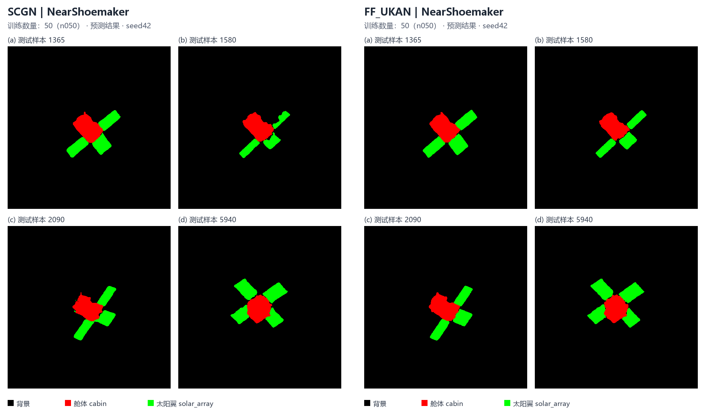

## 重点样本复核

下图保留ISAR样本2656在多个配置下的大面积前景预测，以及NearShoemaker样本1580的全背景输出。SCGN对1580的预测仅作为模型间对照，不代替真实标签；整组指标无法单独确定某张图的精度或误差贡献。

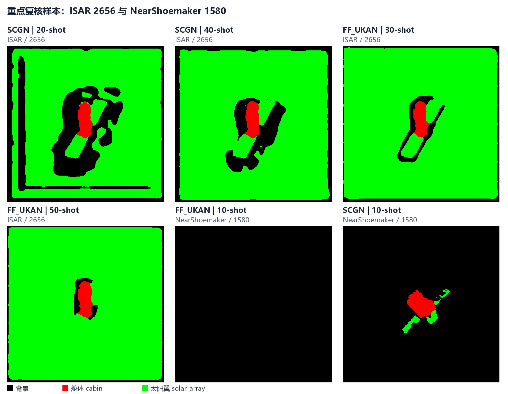

## 本方法在两个新数据集上的分割结果

以下结果均为1-shot、3-shot、5-shot、10-shot，指标单位为 **%**。前景指标平均舱体、太阳翼（舱板）、反射天线三类，先逐图计算再取平均，不含背景；与前文累计混淆矩阵的统计口径不同。图中红色为舱体、绿色为太阳翼、金黄色为反射天线。

### ISAR_数据集_train60_test20（扇形天线）

本方法三类扩展版本：v6/v7e＋天线原型匹配。完整测试范围为20张；清晰姿态8张为其中的展示子集，分别统计指标。

#### 完整20张结果

| 支持样本量 | 前景mIoU | 前景Dice | 前景Precision | 前景Recall | 舱体IoU | 太阳翼IoU | 反射天线IoU |
| --- | --- | --- | --- | --- | --- | --- | --- |
| 1-shot | 50.04 | 55.96 | 57.57 | 59.84 | 27.82 | 43.32 | 79.00 |
| 3-shot | 61.77 | 70.61 | 73.61 | 73.00 | 39.32 | 61.05 | 84.93 |
| 5-shot | 61.27 | 70.18 | 71.81 | 73.97 | 36.55 | 58.31 | 88.94 |
| 10-shot | 49.68 | 59.00 | 57.64 | 69.40 | 30.33 | 40.46 | 78.24 |

#### 图示8张子集结果

| 支持样本量 | 前景mIoU | 前景Dice | 前景Precision | 前景Recall | 舱体IoU | 太阳翼IoU | 反射天线IoU |
| --- | --- | --- | --- | --- | --- | --- | --- |
| 1-shot | 59.45 | 65.71 | 63.55 | 71.14 | 25.73 | 60.23 | 92.40 |
| 3-shot | 66.18 | 73.75 | 75.01 | 77.30 | 38.70 | 64.97 | 94.87 |
| 5-shot | 67.35 | 74.81 | 73.72 | 80.45 | 40.26 | 67.34 | 94.45 |
| 10-shot | 58.79 | 67.88 | 66.07 | 76.50 | 31.97 | 51.16 | 93.24 |

从左至右：原图、GT、1-shot、3-shot、5-shot、10-shot。图示8张子集的指标对应上表，不代表完整20张结果。

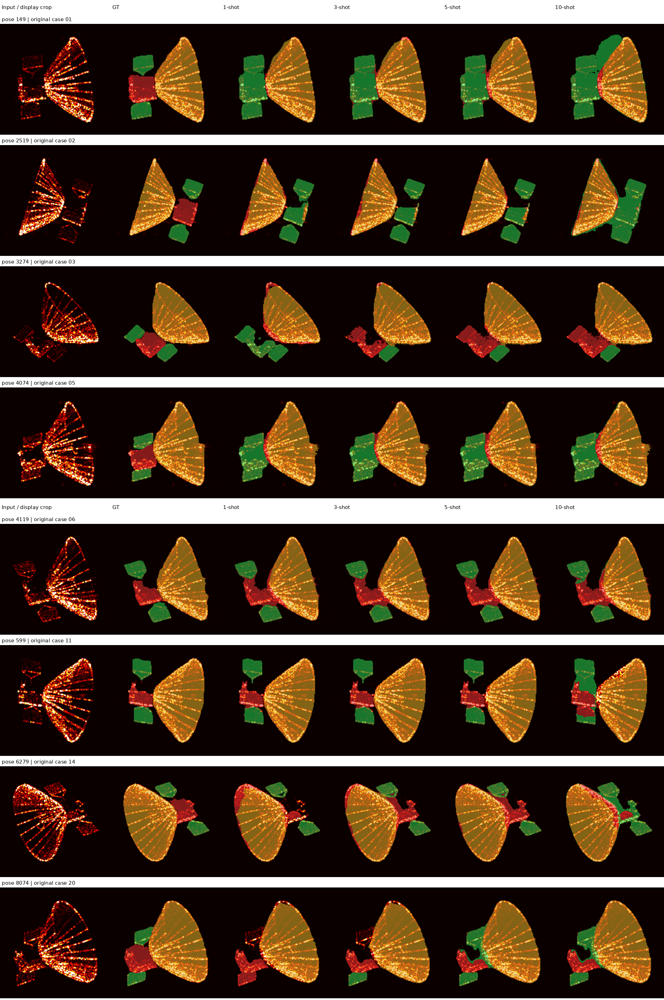

### 非扇形数据集

共100张图像，固定10张支持池，其余90张参与评估；四档使用嵌套支持名单。以下指标统计全部90张，不采用此前按成绩优选的20张子集。

#### 三类扩展原版结果

| 支持样本量 | 前景mIoU | 前景Dice | 前景Precision | 前景Recall | 舱体IoU | 太阳翼IoU | 反射天线IoU |
| --- | --- | --- | --- | --- | --- | --- | --- |
| 1-shot | 57.25 | 62.71 | 64.35 | 64.69 | 84.36 | 66.06 | 21.32 |
| 3-shot | 51.50 | 56.12 | 55.68 | 59.48 | 82.19 | 64.95 | 7.36 |
| 5-shot | 53.77 | 58.84 | 58.03 | 62.60 | 83.37 | 64.80 | 13.14 |
| 10-shot | 59.37 | 64.49 | 64.50 | 67.75 | 82.88 | 67.54 | 27.70 |

#### 候选融合改进版结果（v6＋同等天线打分＋整块掩膜融合）

| 支持样本量 | 前景mIoU | 前景Dice | 前景Precision | 前景Recall | 舱体IoU | 太阳翼IoU | 反射天线IoU |
| --- | --- | --- | --- | --- | --- | --- | --- |
| 1-shot | 69.39 | 73.88 | 75.81 | 76.60 | 87.24 | 67.11 | 53.84 |
| 3-shot | 64.95 | 69.31 | 70.54 | 72.01 | 85.49 | 67.43 | 41.92 |
| 5-shot | 70.10 | 74.81 | 76.11 | 77.99 | 86.89 | 67.73 | 55.69 |
| 10-shot | 74.82 | 79.63 | 81.68 | 82.26 | 87.24 | 69.96 | 67.27 |

以下为9张代表样例，从左至右：原图、GT、原版5-shot、改进版1-shot、3-shot、5-shot、10-shot。上述指标统计全部90张；这些结果属于已参与方法改进的开发评估结果。

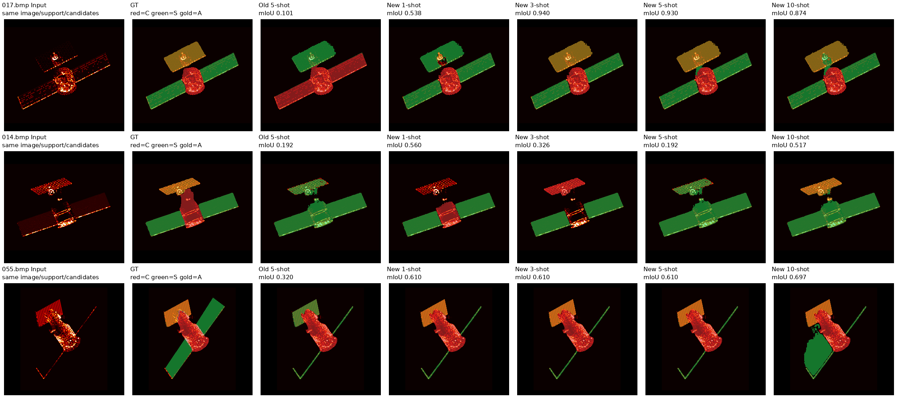

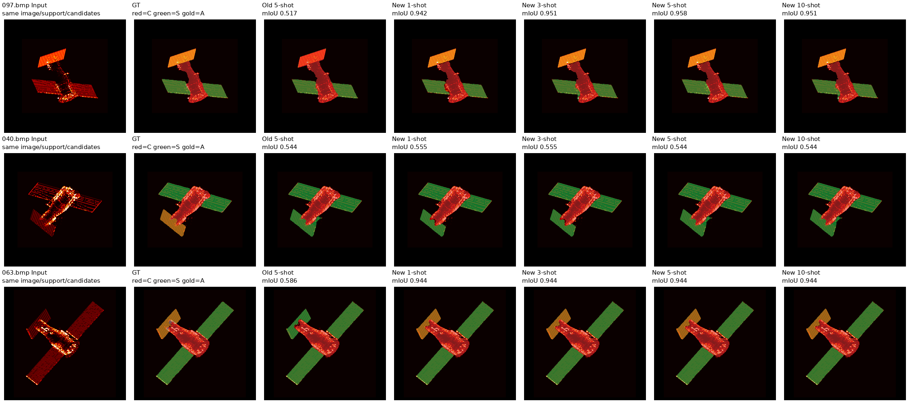

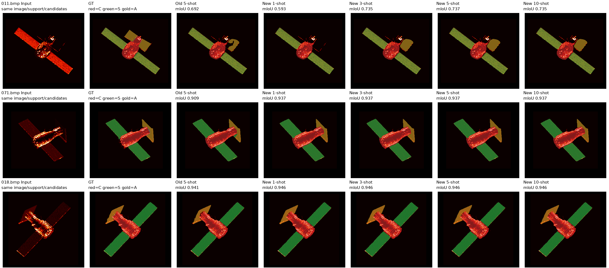

