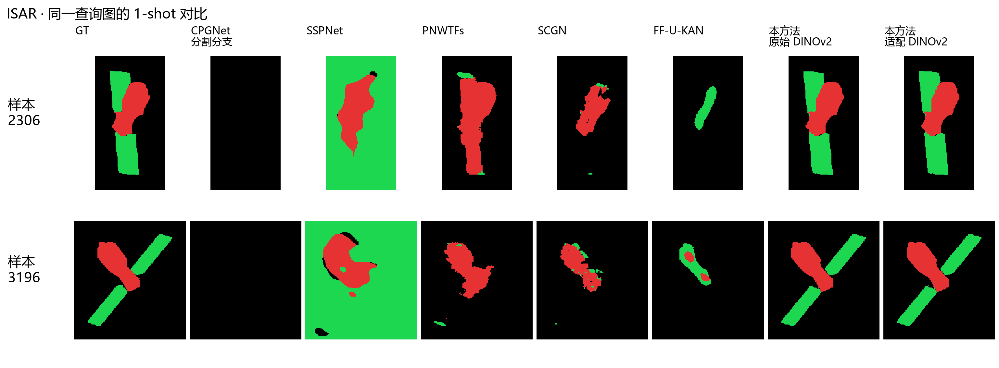
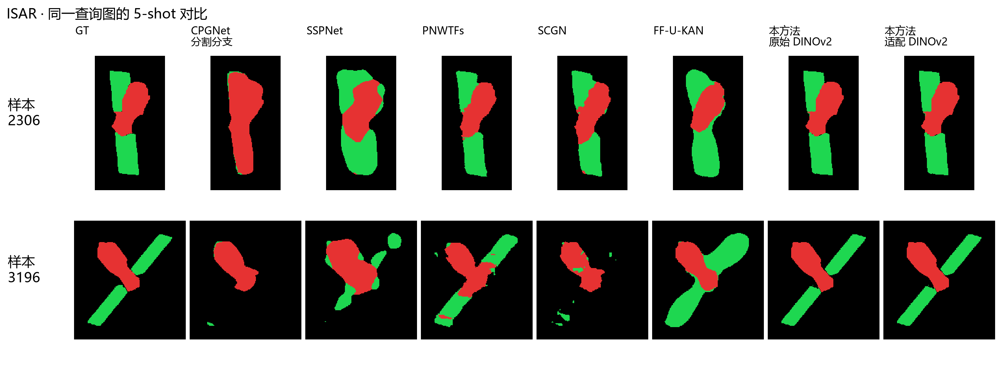
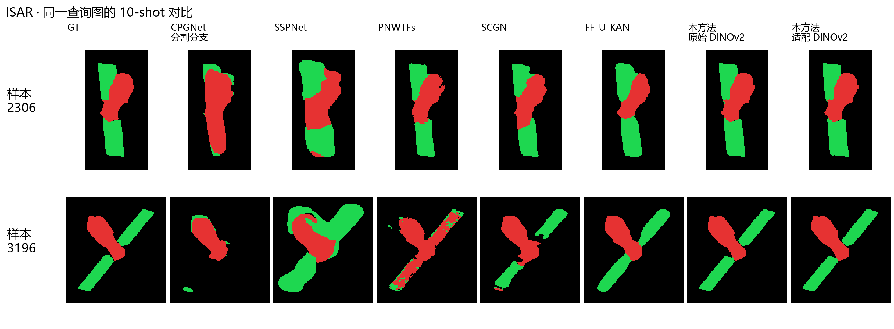
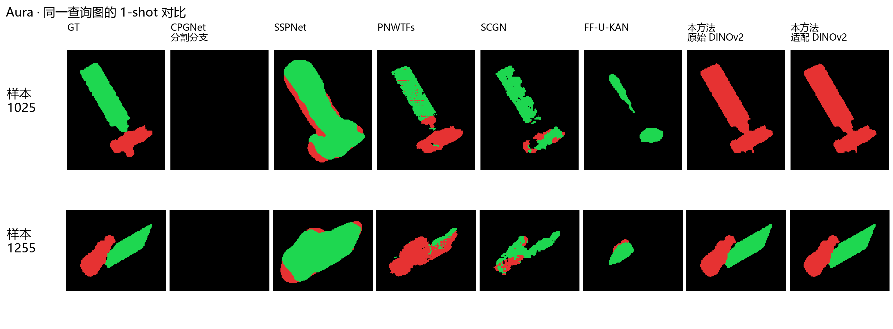
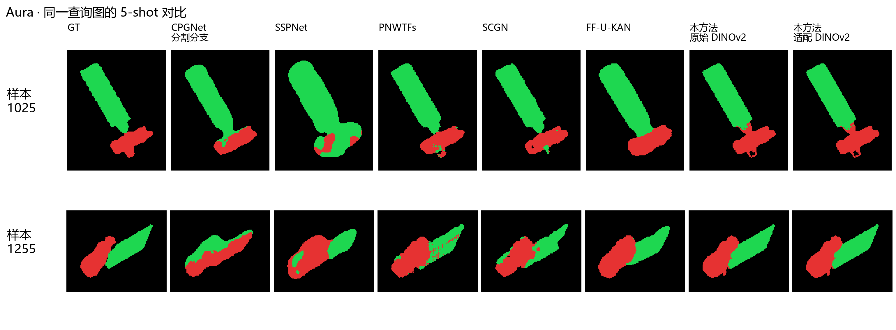
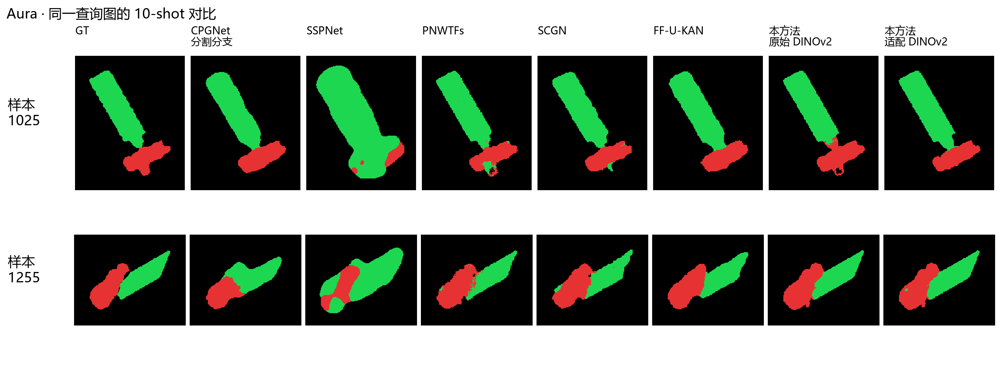
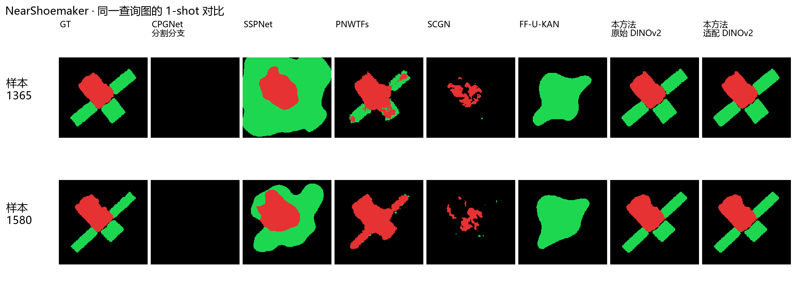
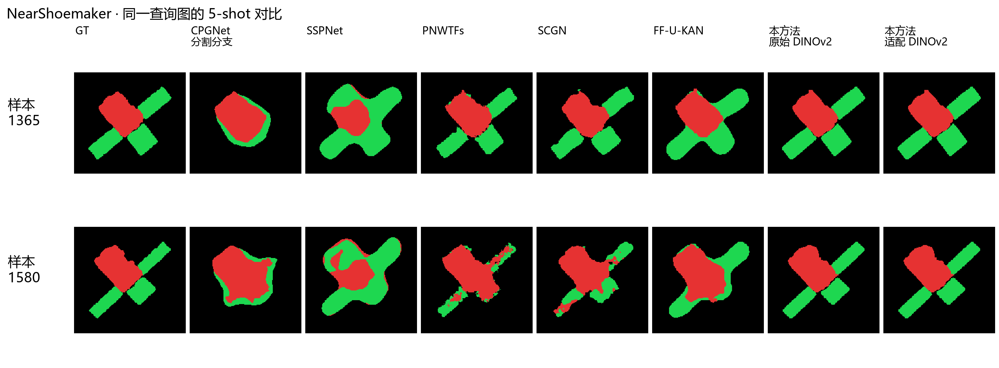
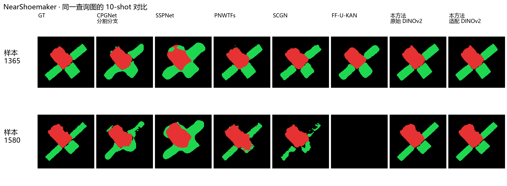
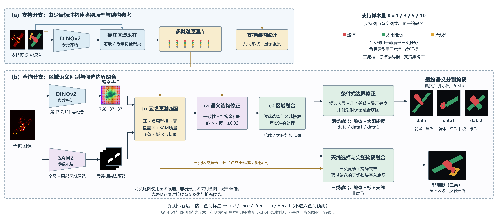

# 周报（ISAR空间目标部件分割实验）

近期围绕空间目标的舱体与太阳能板分割，整理了CPGNet、SSPNet、PNWTFs、SCGN和FF-U-KAN五个方法在ISAR、Aura、NearShoemaker上的105组结果，并与本方法的原始DINOv2、ISAR适配DINOv2两个版本进行对照。完成共同shot条件的指标整理与固定样本展示，同时汇总本方法在四个数据集上的结果。

## 分割实验结果

五个对比方法使用 **seed42、输入512×512**，训练图数量为1、5、10、20、30、40、50，三个数据集测试集分别为38、25、18张。CPGNet采用分割分支消融版本，SSPNet额外使用未标注训练图，SCGN记录了BF16训练。PNWTFs的计划优化更新次数为350～31,300次，其余四方法为50～2,500次。

本方法采用 **冻结DINOv2与SAM2、支持集构建多原型库、候选区域分类与融合** 的流程，支持图数量为1、3、5、10。原始权重与ISAR适配权重各完成四个数据集、16组实验，每个版本共684张预测。前三个数据集共用data1训练支持图，非扇形采用本域固定支持池，评估90张查询图。

主对比采用双方共同具备的 **1、5、10-shot**，共9个条件。原周报归档记录显示，双方查询图文件名集合及GT类别像素总数一致。各方法的支持来源、预训练条件与计算预算按实际配置报告。

以下主表指标单位均为 **%**，采用全测试集累计像素计数计算。**前景mIoU和Dice平均舱体与太阳能板两类，全类mIoU包含背景，OA为总体像素准确率。** 本方法的非扇形评估平均舱体、太阳能板、反射天线三类，排除GT=255的忽略像素。总体平均对数据集与shot条件等权，历史逐图平均结果另列表展示。

ISAR适配DINOv2使用无部件标注灰度图完成自监督适配。适配图与ISAR的 **38/38张**、Aura的 **22/25张**、NearShoemaker的 **15/18张** 查询图存在精确像素重合，适配版结果按这一条件报告。非扇形90张查询图的精确重复检查为0张，目标身份与相邻姿态重合仍待核查。

### 不同训练或支持数量的前景mIoU

| 数据集 | 实验 | 1-shot | 5-shot | 10-shot |
| --- | --- | --- | --- | --- |
| ISAR | CPGNet（分割分支） | 0.00 | 32.45 | 35.64 |
| ISAR | SSPNet | 23.74 | 53.13 | 39.47 |
| ISAR | PNWTFs | 31.00 | 72.96 | 64.09 |
| ISAR | SCGN | 29.73 | 58.09 | 69.77 |
| ISAR | FF-U-KAN | 1.98 | 70.50 | 82.26 |
| ISAR | 本方法·原始 DINOv2 | 83.00 | 92.43 | 92.12 |
| ISAR | 本方法·ISAR 适配 DINOv2 | 85.72 | 93.04 | 92.37 |
| Aura | CPGNet（分割分支） | 0.00 | 58.78 | 70.85 |
| Aura | SSPNet | 16.62 | 43.74 | 36.75 |
| Aura | PNWTFs | 46.16 | 71.99 | 81.35 |
| Aura | SCGN | 29.13 | 76.90 | 78.86 |
| Aura | FF-U-KAN | 6.20 | 77.20 | 84.84 |
| Aura | 本方法·原始 DINOv2 | 30.25 | 88.65 | 87.64 |
| Aura | 本方法·ISAR 适配 DINOv2 | 42.94 | 89.13 | 87.10 |
| NearShoemaker | CPGNet（分割分支） | 0.00 | 37.85 | 75.21 |
| NearShoemaker | SSPNet | 30.99 | 51.99 | 64.27 |
| NearShoemaker | PNWTFs | 55.28 | 71.80 | 81.77 |
| NearShoemaker | SCGN | 22.09 | 78.14 | 83.11 |
| NearShoemaker | FF-U-KAN | 15.37 | 72.52 | 60.54 |
| NearShoemaker | 本方法·原始 DINOv2 | 82.66 | 89.37 | 89.34 |
| NearShoemaker | 本方法·ISAR 适配 DINOv2 | 82.63 | 89.15 | 89.74 |

### 共同条件的平均结果

| 实验 | 前景mIoU | 前景Dice |
| --- | --- | --- |
| CPGNet（分割分支） | 34.53 | 42.12 |
| SSPNet | 40.08 | 53.39 |
| PNWTFs | 64.04 | 75.85 |
| SCGN | 58.42 | 68.95 |
| FF-U-KAN | 52.38 | 61.02 |
| 本方法·原始 DINOv2 | 81.72 | 87.97 |
| 本方法·ISAR 适配 DINOv2 | 83.54 | 90.05 |

## 结果分析

九个共同条件中，五个对比方法以PNWTFs的平均前景mIoU最高，为 **64.04%**。本方法原始权重版为 **81.72%**，高17.68个百分点，适配版为 **83.54%**，高19.49个百分点。对应前景Dice分别为75.85%、87.97%、90.05%。适配版同时包含前述自监督训练图像重合条件。

ISAR上，本方法适配版1、5、10-shot前景mIoU分别为 **85.72%、93.04%、92.37%**，其中5-shot比同条件五方法最高值PNWTFs高20.08个百分点。NearShoemaker适配版的5-shot、10-shot分别为 **89.15%、89.74%**，同条件SCGN分别为78.14%、83.11%。原始权重与适配权重在部分档位存在小幅升降。

Aura的1-shot仍是低分配置，原始版为 **30.25%**，适配版为 **42.94%**，PNWTFs为46.16%。适配版增加到5-shot达到 **89.13%**，10-shot回落到87.10%，需结合固定支持图身份、候选覆盖和融合过程复核。

非扇形10-shot在累计像素口径下，原始版为 **76.59%**，适配版为 **76.33%**。历史逐图平均口径下，对应结果为74.82%和75.62%。两种汇总方式对图像赋予的权重不同，后续继续按相应统计口径报告适配变化。

## 测试结果展示

以下按数据集列出1、5、10-shot指标，每个shot的指标表后均展示相同查询样本的对照图。数值统计完整测试集，图中每行对应一个固定样本，依次展示GT、五个对比方法、本方法原始DINOv2版及ISAR适配DINOv2版。同一数据集的三个shot沿用相同样本。红色为舱体，绿色为太阳能板，黑色为背景。所有列使用同一显示窗口并等比例展示。

“—”表示附件中该项指标待补。本方法的共同条件明细提供了前景mIoU与Dice。

### ISAR

测试集38张，固定展示样本为2306、3196。

#### 1-shot

| 实验 | 全类mIoU | 前景mIoU | 前景Dice | OA | 舱体IoU | 太阳能板IoU |
| --- | --- | --- | --- | --- | --- | --- |
| CPGNet（分割分支） | 32.05 | 0.00 | 0.00 | 96.16 | 0.00 | 0.00 |
| SSPNet | 20.02 | 23.74 | 33.18 | 15.09 | 45.57 | 1.92 |
| PNWTFs | 53.54 | 31.00 | 40.00 | 97.72 | 59.03 | 2.97 |
| SCGN | 52.30 | 29.73 | 37.65 | 97.27 | 58.86 | 0.60 |
| FF-U-KAN | 33.66 | 1.98 | 3.85 | 96.23 | 3.36 | 0.60 |
| 本方法·原始 DINOv2 | — | 83.00 | 90.27 | — | — | — |
| 本方法·ISAR 适配 DINOv2 | — | 85.72 | 92.11 | — | — | — |

#### 5-shot

| 实验 | 全类mIoU | 前景mIoU | 前景Dice | OA | 舱体IoU | 太阳能板IoU |
| --- | --- | --- | --- | --- | --- | --- |
| CPGNet（分割分支） | 54.48 | 32.45 | 40.66 | 97.78 | 62.74 | 2.16 |
| SSPNet | 68.07 | 53.13 | 68.58 | 97.64 | 65.17 | 41.09 |
| PNWTFs | 81.77 | 72.96 | 84.27 | 99.10 | 77.92 | 67.99 |
| SCGN | 71.66 | 58.09 | 71.55 | 98.51 | 77.54 | 38.65 |
| FF-U-KAN | 79.96 | 70.50 | 82.23 | 98.67 | 81.28 | 59.72 |
| 本方法·原始 DINOv2 | — | 92.43 | 96.05 | — | — | — |
| 本方法·ISAR 适配 DINOv2 | — | 93.04 | 96.39 | — | — | — |

#### 10-shot

| 实验 | 全类mIoU | 前景mIoU | 前景Dice | OA | 舱体IoU | 太阳能板IoU |
| --- | --- | --- | --- | --- | --- | --- |
| CPGNet（分割分支） | 56.57 | 35.64 | 46.40 | 97.76 | 62.78 | 8.50 |
| SSPNet | 57.26 | 39.47 | 53.36 | 92.57 | 60.20 | 18.74 |
| PNWTFs | 75.85 | 64.09 | 77.87 | 98.87 | 71.36 | 56.81 |
| SCGN | 79.60 | 69.77 | 81.85 | 99.01 | 78.92 | 60.61 |
| FF-U-KAN | 88.01 | 82.26 | 90.22 | 99.38 | 86.11 | 78.42 |
| 本方法·原始 DINOv2 | — | 92.12 | 95.89 | — | — | — |
| 本方法·ISAR 适配 DINOv2 | — | 92.37 | 96.03 | — | — | — |

### Aura

测试集25张，固定展示样本为1025、1255。

#### 1-shot

| 实验 | 全类mIoU | 前景mIoU | 前景Dice | OA | 舱体IoU | 太阳能板IoU |
| --- | --- | --- | --- | --- | --- | --- |
| CPGNet（分割分支） | 32.11 | 0.00 | 0.00 | 96.33 | 0.00 | 0.00 |
| SSPNet | 42.71 | 16.62 | 25.51 | 93.79 | 1.34 | 31.90 |
| PNWTFs | 63.84 | 46.16 | 63.04 | 98.34 | 50.50 | 41.81 |
| SCGN | 52.18 | 29.13 | 44.77 | 97.68 | 22.99 | 35.27 |
| FF-U-KAN | 36.48 | 6.20 | 11.33 | 96.62 | 1.68 | 10.72 |
| 本方法·原始 DINOv2 | — | 30.25 | 43.05 | — | — | — |
| 本方法·ISAR 适配 DINOv2 | — | 42.94 | 59.48 | — | — | — |

#### 5-shot

| 实验 | 全类mIoU | 前景mIoU | 前景Dice | OA | 舱体IoU | 太阳能板IoU |
| --- | --- | --- | --- | --- | --- | --- |
| CPGNet（分割分支） | 72.29 | 58.78 | 73.98 | 98.77 | 55.25 | 62.31 |
| SSPNet | 62.01 | 43.74 | 60.32 | 97.85 | 34.78 | 52.70 |
| PNWTFs | 81.21 | 71.99 | 83.61 | 99.25 | 66.68 | 77.30 |
| SCGN | 84.45 | 76.90 | 86.89 | 99.34 | 73.20 | 80.60 |
| FF-U-KAN | 84.56 | 77.20 | 87.07 | 99.18 | 73.25 | 81.15 |
| 本方法·原始 DINOv2 | — | 88.65 | 93.88 | — | — | — |
| 本方法·ISAR 适配 DINOv2 | — | 89.13 | 94.17 | — | — | — |

#### 10-shot

| 实验 | 全类mIoU | 前景mIoU | 前景Dice | OA | 舱体IoU | 太阳能板IoU |
| --- | --- | --- | --- | --- | --- | --- |
| CPGNet（分割分支） | 80.38 | 70.85 | 82.90 | 99.14 | 67.65 | 74.06 |
| SSPNet | 57.22 | 36.75 | 52.61 | 97.30 | 24.73 | 48.78 |
| PNWTFs | 87.47 | 81.35 | 89.67 | 99.51 | 77.54 | 85.16 |
| SCGN | 85.77 | 78.86 | 88.15 | 99.40 | 75.85 | 81.87 |
| FF-U-KAN | 89.75 | 84.84 | 91.79 | 99.50 | 82.71 | 86.98 |
| 本方法·原始 DINOv2 | — | 87.64 | 93.30 | — | — | — |
| 本方法·ISAR 适配 DINOv2 | — | 87.10 | 92.96 | — | — | — |

### NearShoemaker

测试集18张，固定展示样本为1365、1580。

#### 1-shot

| 实验 | 全类mIoU | 前景mIoU | 前景Dice | OA | 舱体IoU | 太阳能板IoU |
| --- | --- | --- | --- | --- | --- | --- |
| CPGNet（分割分支） | 31.87 | 0.00 | 0.00 | 95.61 | 0.00 | 0.00 |
| SSPNet | 35.67 | 30.99 | 40.56 | 47.02 | 57.94 | 4.04 |
| PNWTFs | 69.92 | 55.28 | 70.83 | 98.41 | 63.59 | 46.97 |
| SCGN | 46.87 | 22.09 | 31.26 | 96.43 | 42.93 | 1.24 |
| FF-U-KAN | 42.92 | 15.37 | 23.52 | 96.26 | 0.00 | 30.75 |
| 本方法·原始 DINOv2 | — | 82.66 | 90.49 | — | — | — |
| 本方法·ISAR 适配 DINOv2 | — | 82.63 | 90.47 | — | — | — |

#### 5-shot

| 实验 | 全类mIoU | 前景mIoU | 前景Dice | OA | 舱体IoU | 太阳能板IoU |
| --- | --- | --- | --- | --- | --- | --- |
| CPGNet（分割分支） | 57.67 | 37.85 | 49.42 | 96.84 | 64.17 | 11.53 |
| SSPNet | 67.38 | 51.99 | 68.39 | 97.49 | 54.10 | 49.89 |
| PNWTFs | 80.90 | 71.80 | 83.40 | 98.79 | 78.54 | 65.05 |
| SCGN | 85.24 | 78.14 | 87.70 | 99.18 | 81.12 | 75.16 |
| FF-U-KAN | 81.33 | 72.52 | 84.01 | 98.71 | 76.56 | 68.48 |
| 本方法·原始 DINOv2 | — | 89.37 | 94.39 | — | — | — |
| 本方法·ISAR 适配 DINOv2 | — | 89.15 | 94.27 | — | — | — |

#### 10-shot

| 实验 | 全类mIoU | 前景mIoU | 前景Dice | OA | 舱体IoU | 太阳能板IoU |
| --- | --- | --- | --- | --- | --- | --- |
| CPGNet（分割分支） | 83.16 | 75.21 | 85.70 | 98.91 | 81.59 | 68.83 |
| SSPNet | 75.60 | 64.27 | 77.95 | 97.96 | 72.47 | 56.07 |
| PNWTFs | 87.70 | 81.77 | 89.97 | 99.35 | 82.62 | 80.92 |
| SCGN | 88.55 | 83.11 | 90.76 | 99.32 | 85.25 | 80.97 |
| FF-U-KAN | 73.13 | 60.54 | 75.17 | 98.31 | 53.31 | 67.77 |
| 本方法·原始 DINOv2 | — | 89.34 | 94.37 | — | — | — |
| 本方法·ISAR 适配 DINOv2 | — | 89.74 | 94.59 | — | — | — |

## 本方法在四个数据集上的分割结果

以下按 **1-shot、3-shot、5-shot、10-shot** 汇总，指标单位为%。本节采用累计像素口径，前三个数据集平均舱体与太阳能板两类，非扇形平均舱体、太阳能板与反射天线三类。两种权重在同一表中并列。

### ISAR

| 支持样本量 | 原始DINOv2前景mIoU | 原始DINOv2前景Dice | 适配DINOv2前景mIoU | 适配DINOv2前景Dice |
| --- | --- | --- | --- | --- |
| 1-shot | 83.00 | 90.27 | 85.72 | 92.11 |
| 3-shot | 83.92 | 91.24 | 82.33 | 90.19 |
| 5-shot | 92.43 | 96.05 | 93.04 | 96.39 |
| 10-shot | 92.12 | 95.89 | 92.37 | 96.03 |

### Aura

| 支持样本量 | 原始DINOv2前景mIoU | 原始DINOv2前景Dice | 适配DINOv2前景mIoU | 适配DINOv2前景Dice |
| --- | --- | --- | --- | --- |
| 1-shot | 30.25 | 43.05 | 42.94 | 59.48 |
| 3-shot | 75.78 | 86.04 | 76.01 | 86.20 |
| 5-shot | 88.65 | 93.88 | 89.13 | 94.17 |
| 10-shot | 87.64 | 93.30 | 87.10 | 92.96 |

### NearShoemaker

| 支持样本量 | 原始DINOv2前景mIoU | 原始DINOv2前景Dice | 适配DINOv2前景mIoU | 适配DINOv2前景Dice |
| --- | --- | --- | --- | --- |
| 1-shot | 82.66 | 90.49 | 82.63 | 90.47 |
| 3-shot | 87.47 | 93.31 | 85.76 | 92.31 |
| 5-shot | 89.37 | 94.39 | 89.15 | 94.27 |
| 10-shot | 89.34 | 94.37 | 89.74 | 94.59 |

### 非扇形

| 支持样本量 | 原始DINOv2前景mIoU | 原始DINOv2前景Dice | 适配DINOv2前景mIoU | 适配DINOv2前景Dice |
| --- | --- | --- | --- | --- |
| 1-shot | 71.22 | 82.47 | 71.58 | 82.76 |
| 3-shot | 68.53 | 80.36 | 70.11 | 81.57 |
| 5-shot | 71.68 | 82.90 | 72.41 | 83.21 |
| 10-shot | 76.59 | 86.51 | 76.33 | 86.20 |

### 历史逐图平均结果

下表沿用此前工程汇总，先对每张图计算前景mIoU，再对图像取平均，单位为%。

| 数据集 | 权重版本 | 1-shot | 3-shot | 5-shot | 10-shot |
|---|---|---:|---:|---:|---:|
| ISAR | 原始 DINOv2 | 80.64 | 82.09 | 88.27 | 88.35 |
| ISAR | ISAR 适配 DINOv2 | 82.95 | 80.90 | 89.19 | 88.61 |
| Aura | 原始 DINOv2 | 44.20 | 75.96 | 88.70 | 86.45 |
| Aura | ISAR 适配 DINOv2 | 53.20 | 76.60 | 88.93 | 85.93 |
| NearShoemaker | 原始 DINOv2 | 84.60 | 87.89 | 89.46 | 89.44 |
| NearShoemaker | ISAR 适配 DINOv2 | 84.56 | 86.78 | 89.07 | 89.81 |
| 非扇形 | 原始 DINOv2 | 69.39 | 64.95 | 70.10 | 74.82 |
| 非扇形 | ISAR 适配 DINOv2 | 70.00 | 68.06 | 71.33 | 75.62 |

历史逐图平均口径下，适配版在非扇形四档均提高，其中3-shot提高3.11个百分点。原始权重版与适配版各完成16组、684张预测。原周报记录，统一入口重建原始权重的特征与原型库后，684张预测与历史归档逐像素一致。适配权重通过174个张量的严格结构匹配，自监督训练共30轮，最佳教师权重按保存记录对应第16轮。

## 当前网络框架

支持分支利用少量带标注图像建立类别原型与结构参照，查询分支结合DINOv2类别特征和SAM2候选边界，经过区域匹配、语义结构修正及融合得到像素标签。框架图右侧的四幅输出来自各数据集独立运行的原始DINOv2权重5-shot结果，特征色图与原型圆点为示意。

| 模块 | 输入、处理过程及输出 |
|---|---|
| 支持集与标签 | 从固定支持池取 1、3、5、10 张图像及标注，区分舱体、板、背景，非扇形额外含反射天线。前三组使用共享的 data1 支持来源。 |
| 冻结 DINOv2 稠密特征 | 支持图和查询图共用 ViT-B/14 编码器，全图缩放到 518×518，融合代码索引第 [3,7,11] 层，权重为 [0.25,0.35,0.40]，生成归一化的 768×37×37 特征。 |
| 标注区域采样与多原型库 | 在支持标注内采样前景 token，并采集背景 token，按类聚类。背景与其他前景类别为负证据，多个原型用于表示同类外观变化。 |
| 支持结构统计 | 从支持标注与图像统计几何形状和显示强度，形成结构参照，与原型库共同服务查询区域匹配。 |
| 冻结 SAM2 全图及 ROI 候选 | 对查询图生成无类别的全图掩码，再在局部区域提取补充候选，按质量、面积和重复情况过滤，保存候选边界及质量信息。 |
| 区域原型匹配 | 将候选掩码映射到特征网格，提取区域特征，结合正/负原型相似度、覆盖率、SAM 预测 IoU 和稳定度评分。舱体、板的基础评分还含形状项。 |
| 语义结构修正 | 检查候选内部的类别一致性、混合情况与结构亲和度，对舱体、板的得分作最大 ±0.03 的有界修正，并向融合传递区域证据。 |
| 区域融合 | 选择舱体和板候选，恢复遗漏的小板及混合区域中的板，处理重叠冲突，形成舱体/太阳能板底图。两类任务的底图采用全图候选，非扇形底图采用全图与局部候选。 |
| 两类任务的条件式边界修正 | 对 data、data1、data2，结合扩充候选边界、几何关系及查询图显示强度判断是否修正底图，满足条件时更新舱体与板的边界。显示强度的作用按伪彩图先验描述。 |
| 非扇形的天线选择与融合 | 对可评分候选进行独立的三前景类竞争，保留天线胜出且得分通过阈值的候选，再做掩码 NMS，将完整天线区域写入舱体/板底图。 |
| 预测后评估 | 保存语义标签后读取查询图真实标注，计算 IoU、Dice、Precision、Recall，并保留逐图 TP、FP、FN 以支持不同汇总口径。 |

